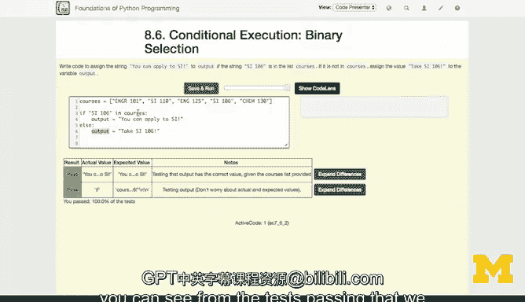

# 密歇根大学《Python3编程（课程1、2）》｜Python 3 Programming（Python for everyone进阶）（中英字幕） - P61：61_03_02_条件执行基础.zh_en - GPT中英字幕课程资源 - BV1CM411Z72u

Welcome back。 So we've already covered Booleions， which allow us to write expressions that evaluate to either true or false。

 But knowing if something's true or false isn't typically that useful on its own。

 Most of the time when we use Booleions， we use them in combination with conditional execution。

 conditional execution allows us to say， run this piece of code， if something is true。

 run this piece of code， if something else is true or run this piece of code if something's false。

 So let's jump right into conditional execution。😊，So we do conditional execution with if in L statements。

 so in this code， we declare variable x and set it here to the value 15。And then we say if。

X modulo 2 equals equals0 as a quick reminder， modulo is the remainder operator， so for example。

 if we take 15 modulo2。Then because 15 divided by 2 is 7 with the remainder of 1。

 modulo gives us only or the remainder， so 15 modulo 2 is 1 if we did 14 modulo 2。

Then because 14 divides evenly into2 is 7， then we get a remainder 0， if we do 13 modular 2。

Then we get a remainder of one and so on。 So in other words， if we take x modular 2。

Then it's going to be0 if x。Is even。And it can be divided by two with no remainder， and it's one。

If x is odd。So in this code， we say if x modular 2 is 0， which to us。

 this is a boolean expression that's going to evaluate to true if x is even。

 and it's going to evaluate to false if x is odd。So we say if it's even， then print out x is even。

Then we say else， so you can think of else as being like otherwise， so else is saying otherwise。

 if this condition is false， then do something else。So we say if x is even， print out x is even。

Otherwise， if x is not even， print out X is odd。So when I run this code， while x is 15。

 then we should expect this else condition to print out x is odd， so let's run our code。Okay。

 so we printed out 15 as odd。And that indicates that we ran what's in this else class。

Let's modify our code slightly to set X instead to an even number like 14 and run it again。

Now we instead get 14 is even。So one thing to note is that we specify what's inside of this if through indentation。

 so just the same way that we specify what's inside of a for loop versus outside of a for loop。

Just like four loops， we can have any number of vines here so I can say print。

It is even in all capital letters。And this is inside of this if。I can put here print。It is odd。

So now when I run my code， I get 14 is even， it is even。And this else clause is ignored。

So let's answer some questions around conditional execution。

So this question asks how many lines of code can appear in the indented code block below the if and else lines in a conditional。

 So in other words， what this is asking is after we have an if。Then we have some boolean expression。

How many lines can we have inside of here，Well， really， we can have pretty much any number of lines。

So I'm going to put one or more because we have to have at least one thing inside of this block。

 but we can have more， we can have any number of things inside of our if block in same thing with our else block。

So this question asks， what does the following code print， choose from ABC or nothing？

So here we say if， and then we have a Boolean expression。4 plus 5 equals equals 10。

So when Python evaluates this Boolean expression， it's first going to evaluate 4 plus 5 because that's higher precedence than the equals equals。

And so4 plus5 evaluates to9。And then it says is9 equal to 10？And when it evaluates this expression。

 then we get false。And so what that means is if we say if and then this expression evaluates to false。

 then we do not run what's inside of this if clause。

 instead we run what's inside of the elsese clause， inside of the else clause， we have print false。

 and so that's what I expect to be printed in this code。So I'm going to answer B。Okay。

Heres a slightly trickier question。We have the same conditional that we had in the previous question。

 so from that I'm just going to note that this is false。So this if does not run。

 but what's inside of this else runs？Now， if we look after this else。

 then you should see this print true。Is not indented。 So in other words。

 this print true is outside of this if else clause。

So what's inside of this else clause is just print false and what that means is that this print true。

Is run regardless of what happens in this if else clause。So from the previous question。

 we know that the else clauses run here because9 is not equal to 10。

So we know that this print false is what runs first。

 but then this print true gets executed regardless of what happened in this if else clause。

 so I expect false to be printed， then true to be printed， so in other words， answer C。

So now I'm just going to go through one of these questions， the rest are fairly similar to this。

 so you should try them on your own。Here we're asked to write code that assigns the string you can apply to s i to output if the string s 106 is in the list courses。

So I'm going to start by writing。The Boolean expression to evaluate whether this is true or false。

 so is the string S 106 inside of the list courses。

So you might remember that the way that we do that is we can say S I106。In courses。

This is a boolean expression that evaluates to true If S 106 is in courses and false if S 106 is not in courses。

Now， if I want to do something， if this Boolean is true， then I can write if。

And then add a colon after this。And now what do I want to do if SI 106 is in courses。

 while it says right code to assign the string， you can apply to SI to the variable output in that case。

So inside of this， if I'm going to write output。Equals the string you can apply to S exclamation point。

And now it says something to do if S 106 is not in courses， so if it's not in courses。

 assign the value， take S 106 to the variable output。So， I'm going to say。Else。So in other words。

 ifSI106 is not in courses output。Equals。Take S I 106 exclamation point。Okay。

 so even though my code doesn't actually print anything here。

 you can see from the tests passing that we correctly assigned the variable output。

