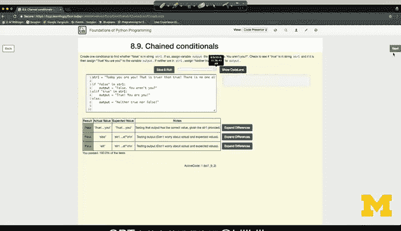

# 密歇根大学《Python3编程（课程1、2）》｜Python 3 Programming（Python for everyone进阶）（中英字幕） - P62：62_03_03_单分支选择、嵌套条件与链式条件.zh_en - GPT中英字幕课程资源 - BV1CM411Z72u

So sometimes we can actually omit the else clause if we don't need it。

 we can just have an if with no accompanying else。So in this code。

 we first assign the variable x to 10， and then we say if x is less than 0， so in other words。

 if x is negative， then we print this out。Note here we don't have an else after this if。

 instead we just have a print statement that as the contents imply， always gets printed。

So when we run this code， because x is 10， we should expect the expression x less than 0 to be false。

 and so we should expect only this is always printed to print out。If we run our code。

 that's the case。Now， what if we changed x to be negative 10？Rather than running this code。

 I'm just going to go to this multiple choice question， which has that exact code。

 So we first have x equals negative 10。Then we say if x is less than0。

 then print out the negative number x is not valid here， then we print out this is always printed。

So we should expect that because negative 10 is less than0， that this if cause is going to execute。

 so it should print out the negative number negative 10 is not valid here。

And then this is always printed because it's outside of the if should be printed as well。

So our answer should be B。In this question， we have similar code， so we say x is negative 10。

 If x is less than 0， then print out the negative number X is not valid here but then we add in else saying otherwise。

 print X is a positive number。But then we have another else。That prints out， this is always printed。

And the question is， will the following code cause an error？And the answer is going to be yes。

The reason is that every else has to have an accompanying if。Right。

 so you never would start off a conversation or a sentence by starting with otherwise。

 If you do that， then it's like， well， otherwise what。

 you have to have a thing that you're saying otherwise in response to。

 So every else always has to have an accompanying if。 So this else corresponds with this if。

This else has no if that it corresponds with， and so Python says I don't understand what we're actually writing here。

 and so it's going to give us a syntax error。So yes， this could cause an error。

One thing to note with conditionals is that inside of an if block or an else block。

 we can also have another set of conditionals。 So remember that whatever goes inside of a block。 So。

 for example， inside of this else block is all indented。It only runs if what's inside of this。

 if is false。But we can have other if and else statements inside of either of these blocks。 So。

 for example， here inside of this else block， we have another if statement saying if x is greater than y then do something otherwise in this else corresponds with this if。

So otherwise， print x and y must be equal。So these are what are called nested conditionals and you can have any level of nesting。

 so for example， this if block could have another FL statement。

 which could have another ifL statement as many times as we wanted to。So when we look at this code。

 we first assign x and y to 10 on lines 1 and 2。Then we say if x is less than y so1 is not less than 10。

So this statement is false。And what will happen is will'll jump to the else。

And then we say if x is greater than y。But 10 is not greater than 10。 So this is also false。

So we then jump to this else。 And what gets printed out is x and y must be equal。

So let's run our code just to verify that this is the case。So we get x and y must be equal。

Let's change our values for X and Y a little bit。So let's start by changing x to instead B5。

So when we change x to 5。Then this， if x is less than y。 So 5 is less than 10。 That's true。

And so we print out x is less than y， and we skip this entire else block。

 So the only thing that gets printed out is x is less than y。Okay。

 so now let's change our numbers slightly again， so I'm going to say x is 10 again。

And I'm going to change y to be3。So now。Ten。Less than three。This is false。So we skip to the else。

And then we say if x is greater than y，10 greater than 3。Is true。

So we run what's inside of this nested if。And we print out x is greater than y。

So we're going to come back to this code and learn one new construct of if andL statements called an LLF。

 but before then let's answer some questions。So in this code。

 we have another nested conditional because this else has an if else inside of it。

 And the question we're asking is， will this code cause an error。Well。

 I don't see anything invalid in this code because this else is allowed to have this， if else in it。

And so I'm going to say， no， this code is not going to cause an error。

So let's actually figure out what this code is going to output。

So we assign x to be negative 10 first， and then we say if x is less than 0。

 print out the negative number， negative 10 is not valid here。And because this， if ran。

 then we entirely skip this else。 So the only thing that would get printed is the negative number。

 negative 10 is not valid here。Now， recall this code from the nested conditionals discussion。

 So here we assign two variables， X and y to be numbers。 And if x is less than y。

 we want to print out x is less than y。 If x is greater than y。

 we want to print out x is greater than y。 and if theyre equal。

 we want to print out X and y must be equal。So far。

 we've needed to do this through nested conditionals。 so in other words。

 this L statement had to contain another if statement and L statement。So in other words。

 if x is less than y， we print out x is less than y。If x is not less than y。

 but it is instead greater than y， then we print out x is greater than y。

If x is not less than y and x is not greater than y， then we print out that they must be equal。

 but Python offers a cleaner way to express conditionals like this。So in this case。

 rather than having an if and else contained within this else， we can write something called an LF。

So an L if is short for else if。So， LF。Looks exactly like this。

So now we have the exact same logic that we had before。

 but it's a little flatter and doesn't require nesting。So we say if x is less than y。

 then print out x is less than y just like before。But then after that， we write EF。

 which again is short for Elif， so in other words， if x is not less than y。

But x is greater than y Then we print this out。And now， this else is saying。

 if none of the conditions in this LF or this if were true， then run what's in here。

So when I run this code， when x and y are 10， then I'm going to print out x and y must be equal。

So just like else， every LI has to have an accompanying if。

So this L if corresponds to this if and this else corresponds to this if as well。Remember。

 you don't start off a sentence or a conversation by saying otherwise。Likewise。

 you aren't going to start off an if conditional by saying L if。 you always have to start with an if。

So here's a diagram that explains where use if EF and else。

So every conditional group always starts out with exactly one if。So we have if。

 and then some booleing expression， and then some code to run if that booleing expression is true。

Then we can have any number of LFs。 In other words。

 we can have zero or more LFs that come right after that if。So if we say L if conditionition 2。

 then this block runs if condition 2 is true and nothing earlier in this if group ran。

 so in other words， condition 1 was not true。This LF condition 3 runs if condition 3 is true。

 and condition 1 in condition 2 were not true。And so on， so at conditionition X。

 then this runs if condition X is true。And none of these out there， ifs or LFs were true。

So then after the if in any number of LFs， we can have either0 or 1 L statements。In other words。

 we can omit this cell statement or we can have one of them。

this L statement is going to run only if none of these conditions inside of this， if black were true。

So in other words， this is saying if something's true。Otherwise。

 if that thing was false and this thing is true。Otherwise， if everything else so far was false。

 and this is true。And then the else is saying， otherwise， if everything so far was false。

 then run this。So for example， here are some valid if LFL orders so we can have an if with nothing else。

We can have an if with 1 L statement。We can have an if that has one LF and an else。

and we can have an if with two or any number of outs with no else。

So let's answer some questions about if LFN else。So here we have some code。

 and the question asks which one of one，2， or 3 gives the same result as the following nested if。

 So in other words， what we're doing is we're trying to replicate this code with an LF。

So what I would do is I would say， okay， if we join this if in L into an LF。

 so I would say if x is less than 0。Eph。X greater than 0， and then else。So。

This code is not valid because we have else and then a conditional， but whenever we write else。

 we can't have a conditional。 So we know that the answer isn't one， and in fact。

 one would cause a syntax error。For answer 2， we have pretty much exactly what we wrote here。

 So we joined this else and F。And made this else。A clause on this if。

And so I'm going to say that the answer is answer 2， but let's look at answer 3 just in case。

So we have an if x is less than 0。Then print out the negative number x is not valid here。

 and then we have another if。 So in other words， we have one if clause that goes from here to here。

And another if group that goes from here to here that includes an else。Now。

 this code looks like it's going to be exactly the same， but it's actually a little bit different。

So I'm going to answer number two is the answer here。Oops。

And we can tell that that's the right answer。So this question asks。

 what will the following code print if x is equal to 3， y is equal to 5 and z is equal to 2。

So here we have a slightly more complex Boolean expression to say if x is less than y and x is less than z。

So first is three。Less than 5。Yes， that's true。And then we ask， is three。Less than two。That's false。

And so true and false is false。So this if does not execute。If y is less than x。So，5。

Is not less than three。 So we know that this is going to be false。

And we don't even need to know whether this is true or false because we know that false and any other value is going to be false。

And so what that means is that we run what's inside of the else clause， so we print out C。

In this question， we're asked to write code。Using one conditional to find whether the string false is in the string S R 1。

 which is specified here。So I'm going to first write out the Boolean expression to express that so that's the string false。

In STR 1。And the question we say。If that's true， then assign the variable output to this string。So。

 I'm going to say。If this is true。Then。Output equals the string false。 You aren't you question mark。

And then it asks， check to see if the string true is in STR1， and if that is。

 then assign true you are U to the variable output。 So I'm going to put that in in LF。 So LF。

True is in SR 1。Output。Equals。Chi。You are you。If neither are an STR1。

 then assign this string to the variable output。 and so we're going to express that within else。Else。

 remember else doesn't take a condition because its condition is implicitly that neither of these conditions were true。

So we say else。Output equals neither。True， nor false。

I'll leave it up to you to complete the remaining exercises。

