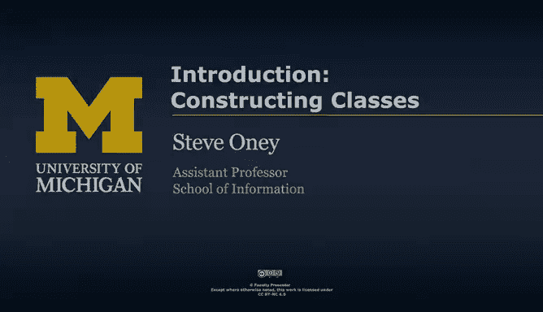

# 密歇根大学《Python3编程（课程3、4、5）》｜Python 3 Programming（Python for everyone进阶）（中英字幕） - P63：06_02_01_引言：类的构建.zh_en - GPT中英字幕课程资源 - BV1gj41177yd

Welcome back。In this lesson， we're going to start to learn about Python classes。

 as we'll see in the coming lessons， Python classes can help us better structure and organize complex code。

Classes are in the backbone of an idea called object oriented programming。

 and the idea of object oriented programming is essentially to organize code around objects。

For example， suppose that you're writing code that tracks car inventory for a rental car company。

I know that I could use dictionaries and lists to track things like which cars are checked out what their features are。

 etc， however， I might be able to write cleaner code if I instead create a car object to represent each car。

Then I could have properties for each car to represent things like its color， size， top speed， etc。

I could also have functions that belong to each car instance so that I could do things like check out the car by saying something like car do check out。

 I could also have other objects to represent customers， employees， etc。

Now all this stuff is possible to do without classes。

 but classes can give us a cleaner and more concise and more organized way to represent data like this。

When you finish this lesson， you'll better understand how to create classes， methods， and instances。

 so let's dive in。