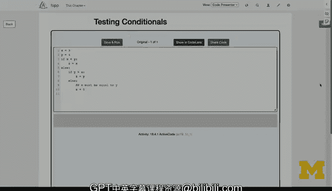
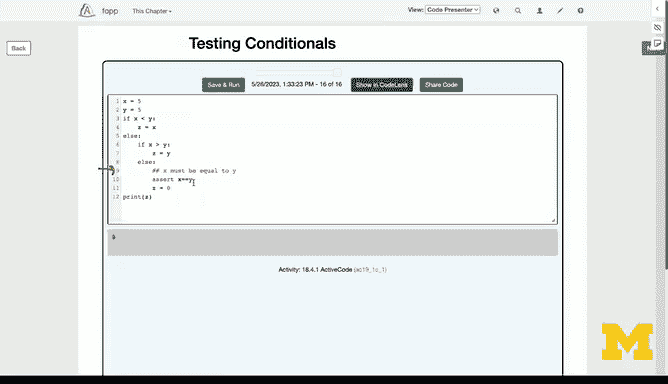

# 密歇根大学《Python3编程（课程1、2）》｜Python 3 Programming（Python for everyone进阶）（中英字幕） - P63：63_03_04_条件测试方法.zh_en - GPT中英字幕课程资源 - BV1CM411Z72u

When you write conditionals， you'll be reasoning in your head about what has to be true when the interpreter gets to certain places in the code。

Sometimes your inferences will be right。Sometimes they won't。

 either because you forgot about the possibility of some edge case or perhaps just because you have a typo or some other error in your code。

You can help your debugging if you get in the habit of adding comments at certain points in a conditional that express assumptions。

About constraints you think will be satisfied if the execution ever gets to a particular block of an NFL's conditional。

For example， here。On line 9， I added a little commentt。It X is less than y， do one thing。

 if the other thing happens。If either of those is true， then x must be equal to y。

So I added that little comment。I， but once you've written a comment。

 you might want to translate it into an assert statement。

 Not only does that force you to be more precise， but if your assumptions's ever wrong。

 you'll get an error notifying you about it right away。

You'll be converting a semantic error where the program would just keep going and produce the wrong output into a runtime error where the execution stops。

 and that can be really helpful for debugging， you'll be able to fix the program much faster if you know that a particular assumption you are making is violated。

So let's try some different values of x and y in this execution。And。And we're going to print。Z。

 at the end of each of them。So when x is3 and y is 4， we get that z is3。If I switch that around。

Four and three。Then I get zero， if I do seven and three， I still get zero。I do 0 and3， I get。0。😔。

Then awful a lot of zeros。Maybe that should worry me a little bit。

Let's translate this comment into an assertion。I think that when I get to this point in the code。

 x has to equal equal y。I can do that with or without the parentheesis。X and Y ought to be the same。

Can now let me run this。No problem when x equals0 and y is 3， if x is 2 and y is 3。

Also no problem when x is 4 and y is 3，0。I got error， an assertion error on line 10。Daad。😔。

This assertion。X is not the same as y。Okay。I made this comment to myself。

 and I added this assertion because whenever I get to line 10， X ought to be the same as Y。

 Or at least that's what I thought I did。Y is not bigger than X。 Xs not bigger than Y。 Oh， oops。

I actually didn't check。The two different possibilities here， I'm not checking if x is less than y。

And if x is greater than y。I could just do this with if y is less than x or I can do it with if x is greater than y。

But what I had before was actually checking the same condition。So if I do this。

I've now fixed my code。So that I'm really doing what I thought I was doing before。And now I get。

With four and three， I get an output of three， with two and three。I get two。

So z is going to either be equal to x or it's going to be equal to y。

 and we're never going to have this problem of the assert statement failing。After I fix the code。

 the assert statement seems to always pass， and I get z equals0 only when x and y are the same。

That when x is less than y， I don't get it， when x is greater than y， I don't get it。

 but when they're equal。I get zero and the assert is always true。

I only get to line 10 in the execution if x has the same value as y。

I'll see you next time。