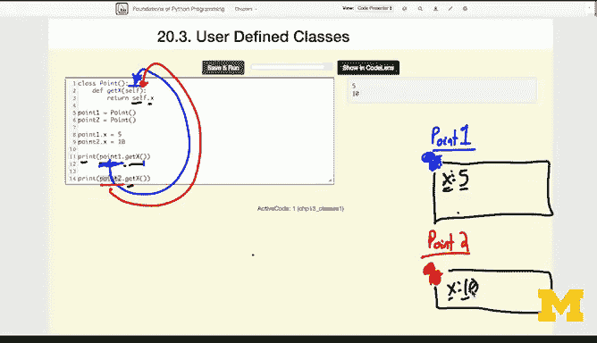

# 密歇根大学《Python3编程（课程3、4、5）》｜Python 3 Programming（Python for everyone进阶）（中英字幕） - P64：07_02_02_用户自定义类.zh_en - GPT中英字幕课程资源 - BV1gj41177yd

Welcome back In this lesson， we're going to learn the basics of classes。

 Classes are a nice and convenient way to represent data because they bundle the data and associated functions or methods that we care about into one object。

 So， for example， we've worked with strings， and we've seen the dot split method that you can call on strings。

 the dotta pen method that you can call on lists and dot forward and dot backwards that you can call on turtles。

 In this lesson， we're going to learn to define our own custom classes。

So let's suppose that we wanted to create Python objects to represent a point。

 And when I say a point， what I mean is that we have x and y。And along this scale。

 we might have a point。 So this point， for example， might be at x equals 10。Y equals 2。

You might have this point。At x equals 8。Y equals negative 3。E cea。

So let's create a Python class to represent points。

So the way that we create a class is we write the keyword class。And then we give the class a name。

 so I'm going to call this class point。Then I'm going to add open and closing parentheses。

And thecoon。And I'm just going to leave this empty by saying， pass。Now， what we did。As we said。

 we want to create a new class with this class keyword。

Convention is that we always start class names with a capital letter。

 So that's why I'm calling this capital P point。And then we have these optional opening and closing parentheses。

 which I'll talk about more later on。 and we say colon， and then inside of here。

 we have the body of the class， which I'll get two more later on again。

So before I fill out this class， what I'm going to do is I'm going to create what are called instances。

 So if you think of a class as kind of a factory， instances are the things that the factory produces。

 So in this case， the a point class。Is like a factory for creating new points。

The way that I create an instance of point is I'm going to say something like point1。Equals。point。

I can say， point2。Equals0， as well。So what I've done here is I've created two instances， 01 and 0。2。

And now， even though this looks a lot like calling a function because I have the name of the class and then opening and closing parentheses。

 this is actually doing something slightly different than calling a function。

 It's instead creating an instance of this point class。 So again。If we have this graph。

Every instance of a point is going to represent eventually at least one individual dot on this number line。

Okay。So if I just print out， what is the value of 01 by saying print01。If I run this code。

 then I can see that this is a point object。If I print out。22。And run my code。

 then I can see point 2 is another point object。If I ask is point one。Equal to  a point2。

Then I'm going to see that， no， these are separate objects。 So， again。

 point1 and  point2 are different instances。Now， the first thing that we can do with an instance is we can set what's called an instance variable。

An instance variable is a variable that kind of lives inside of an instance。

So if I say01 dot x equals 5。And let's say， I say point2。Dot x equals 10。

Then these are setting instance variables called x for 01 and 02。Now， if I print out。01 dot x。Then。

 I'm going to get 5。If I print out。Po2 dot x。Then， I'm going to get 10。

So let me draw this out just to be sure。So， I have point one。And I'm going to represent it。Like this。

唔知。I'm going to represent 01 as an object that has its own attributes。 So  point1 has x set  to 5。

And I'm going to draw a point to。As an object that has x set to 10。Okay。Now。

 that's all well and good。 so 0。1 and 0。2 have their own different values of the instance variable x。

Now， let's actually start to fill in our class point。

What I'm going to do is I'm going to start by defining what's called a method。

So a method is like a function， except it belongs to a class。

So I'm going to start by defining the method get x。 So I'll say de。Then the method name。Get x。

And then the arguments of the method。 So one difference between methods and functions is that methods always have at least one argument。

 And that first argument is called。Self。We'll get more into that in a little bit。Okay。

 so I have this method， get X self。 I need to fill it in。

 What I'm going to return for now is I'm just going to return self dot X。Now。

 what I'm going to do is I'm going to replace my call to print point1 dot x。2。

 a call to print point one dot get x。Now， when I call GX。

 I'm going to call it with no arguments again， more on that in a little bit。

I'm going to delete this call to point2 dotedex。Now， when I run my code。

You can see that if I call point1 dot getex， then I get5 as the return value。Now。

 what's going on here？ So why did I have this thing self， Why did I return self dot X。

 and why is it that get x said that it took in one argument， self。 But when I called it。

 I passed in0 arguments。So in order to explain that。

 we need to understand a little bit more about how methods work。 When we call this method。

01 dot getex。Then one of the differences between methods and functions。 Remember。

 methods belong to a class。 So whenever we call a method， we have a particular。

 actually instance that we're calling that methodon。 So in this case， we aren't just calling Gx。

 We're saying point1。Dot getex。And so when we say 0。1 dot getx。

 what happens is that we're automatically passing in this instance， 0。1。As self， when we call getx。

So when we say 0。1 backt getx。Even if we have no arguments here。

 and what Python does is it automatically takes what's before the dot or the instance that we're calling this on。

 and it passes it in。As the value of self。If we had instead replaced our code to say。Print。Print。

Point。2 dot getex。Then what would happen is instead of passing in 0。1， then we would be passing in 0。

2， so we would have said 0。2。 getx would pass in 0。2。As the value for self。And now。

 in the body of Gx， then what we do is we say return self dot x。

 And so what that's going to do is on this first call on line 11。

 it's going to return 01's value for x。 So we get 5。On this second call on line 14。

 when we say 02 dot x， then we look in when we see self and ask for a self dot X。

 then we instead get 10。 And so what that means is that the first time we call this。

We get 5 because01 dot x is 5。 The second time we call this。We get 10 because 0。2 dot x is 10。

That's off for now， Until next time。