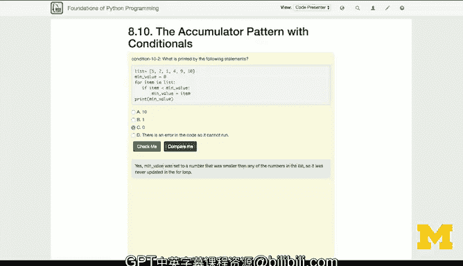

# 密歇根大学《Python3编程（课程1、2）》｜Python 3 Programming（Python for everyone进阶）（中英字幕） - P64：64_03_05_带条件判断的累加器模式与最大值累积.zh_en - GPT中英字幕课程资源 - BV1CM411Z72u

So previously we've discussed the accumulator pattern but the accumulator pattern becomes even more powerful when we combine it with conditionals。

 so recall that the accumulator pattern involves three broad steps， so first we initialize。

In a ch variable。And then， we iterate through。The relevant sequence。

And then as we iterate through that sequence， we update。Our accumulator variable。And then in the end。

 the accumulator variable。If we did these steps right， has the answer that we want。Okay。

So let's apply this template and use it in combination with conditionals。

 so suppose that we have a phrase here。And we want to count the number of characters that are not spaces。

 so in other words， we want to count1，2，3，4， we want to skip the space，5， skip the space，6， seven。

 and so on。Then we can use the accumulator pattern with conditionals。

 the way that we can do that is here we initialize our accumulator variable total to be0。

 in other words， the number of nonspace characters that we've seen so far。

Then we iterate through our sequence， in this case， its phrase。

And then we update our aumulator variable。Appropriately。So in this case。

 we want to say we've seen one more non character space if the character in our phrase is not a space。

So we write if character and then exclamation point equals， that's to say not equal to。

 so if character is not a space， then we say total equals total plus1。So when we run our code。

 it's going to count the number of non space characters。In this case， it's 26。

If we had only spaces here。Then we would get zero。If we had。Three non space characters。

 then you would get three and so on。If we wanted to solve a slightly different problem。

 so let's suppose that we want to count the number of vowels inside of this string S。

 then we take the same broad steps so we initialize our accumulator variable。X to be 0。

Then we loop through our sequence。And then， we say。If this character I。

 so I is the individual character， so if it's in this list AeIO U。

 so in other words this is saying if I is a vowel， it's one of AEIO or U。If it's a vowel。

 then we update our accumulator variable X to add one onto it。

And so the result is that we're going to count the number of vowels。So when we run our code。

 we can see that there are eight vowels in this string s。So we can visualize this with an example。

 so here we want to count the number of Ozinon monooppeia。And in our code。

 we loop through every character and we say if the character C is the character O。

 then add1 to O count。And the result is that we're going to loop through every character in our word and print out the number of O's in our word。

So when we see the first O， we add one onto it。When we see the second O， we add another on it。

Then we keep looping through every time we see an O， we increment O count by one。

And when our code is done running， then the O count would be four and we print out there are four O's in on amountoppiia。

Another common pattern that mixes conditionals in the accumulator pattern is what's called max value accumulation。

So in max value accumulation， we're trying to find the largest thing in a list of things。

So in this example， suppose that we want to find the largest number in this list of numbers。

 so nus is just a random list of numbers。And what we're going to do。

Is we're going to use the accumulator pattern to keep track of the best or highest number that we've seen so far。

So in other words， we assigned best。Underscore numb。So at first。

 we just assign it to be the first number that we see。So we assign best nu to be9。

And then what we're going to do is we're going to loop through all of the numbers in nus and say if we find a higher number than our best number so far。

 then we're going to update best nu to be that number， so we say for every number n。

If n is greater than the best number that we've seen so far， then reassign best nu to be n。

So I'm going to simulate execution on this code before actually running it。Okay。So first。

 we assign best nu to be the first number。Then we loop through every number。

So after we assign best nu to be the first number， then we loop through every number。

 so first n is going to be 9， and we say is9 greater than best nu which is9， it's not。

 so we then loop through to the next number3。Is3 greater than9， it's not。

 so we loop through to the next number 8。Is8 greater than9， it's not。

 so we loop through to the next number 11。And then now when n is 11， we say is 11 greater than 9。

 it is， so we reassign best nu from9。To instead be 11。And then we loop through to the next number5。

And rather than comparing it to 9， because best nu is now 11， we compare is 5 greater than 11。

 It is not。 So we loop through to the next number 29， and we ask， is 29 greater than 11， It is。

 So we reassign best nu to be 29。And then after we've done that， and is now2。

 and we ask is2 greater than 29， it's not。And so at that point。

 because we've gone through all the numbers in our sequence， then we're done with this for loop。

And when we're done with this for loop， best num has been assigned to 29， and so we print out 29。

So in other words， our strategy for max value accumulation is to keep track of the highest value that we've seen so far and then to loop through every item in the sequence。

And if we see a number higher than the highest one that we've seen so far， then reassigned。

Our highest that we've seen so far to that higher number。

 and we know that by the time this for loop is done running。

 then best nu is going to be the largest number that's in our sequence。So when we run this code。

 we should expect 29 to print out and we see that it does。

If I change this sequence to instead have 50 instead of five。

 then we should now expect 50 to print out。And so on， if I change this to be 200。200 would print out。

 so it always prints out the largest number in this sequence。So in this question。

 we're asked what is printed by the following statements。

 so we assign s to the string we are learning。Then we assign x to B0。

 so x here is our accumulator variable。 S is the sequence that we're iterating over。

 and we say if I is an ABC D E， so in other words， if it's one of these characters。

 then we assign x to be x plus 1。Then at the end， we print out what's the value of x。

So this is the accumulation pattern and we're accumulating the number of characters that are AB，C。

 D and E， so in order to answer this question， we have to count the number of ABC Ds and E's in the string S。

 so I see 1，2，3，4，5。And so I expect the answer to be five。

So this question asks what's printed by the following statements。

 so we have a variable called min value that gets assigned to0 and we have a list that we're iterating over in this for loop。

And we say if an item in this list is less than min value then min value equals item。

So here we assign min value to 0。 And one thing I notice right away is that no item in this list is actually less than 0。

 And so what that means is that this booleing expression is never going to be true because we don't have an item that's less than 0。

 And so I expect this to never run。And by the end of our loop， min value is going to be0。

So if we actually wanted to。Collect the minimum value in this list rather than assigning min value to be0。

 we should assign min value equals the first item in the list。 so in other words， list sub0。

And then mint value would start out as5， and we would do a form of max value accumulation。

So as we've seen， the accumulator pattern becomes even more powerful when we combine it with conditionals。

That's all for now， until next time。

