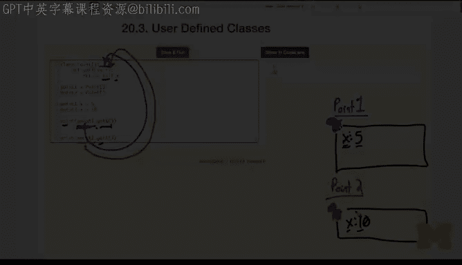
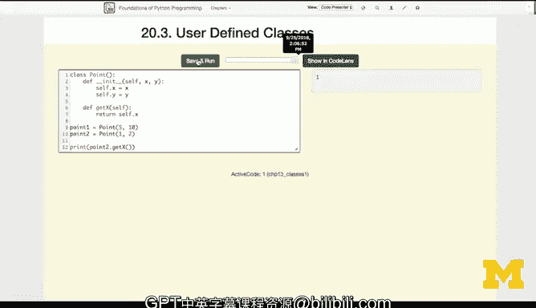

# 密歇根大学《Python3编程（课程3、4、5）》｜Python 3 Programming（Python for everyone进阶）（中英字幕） - P65：08_02_03_为构造函数添加参数.zh_en - GPT中英字幕课程资源 - BV1gj41177yd

Welcome back。

So in this piece of code here we set the instance variable for x for both 0。1 and 0。

2 on lines 8 and 9。Now， even though you can do this in your Python code。

 this isn't the way that you should set instance variables。So instead。

 you should set instance variables in what's called a constructor。Now。

 a constructor is a special method that's meant to initialize Python instances。

 including instance variables。So the constructor is named what's called underscore， underscore in it。

Underscore， underscore。And it's just a special method with this name， underscore， underscore in it。

Underscore， underscore。Now I'm going to call this instead of underscore underscore。

 I'm going to say underscore。So that would make this thunderco in it underscore。

 But instead of saying underscore a knit， underscoreco。

 I'm just going to say underscoreco in it for now。Okay。

 so we want to define our constructor underscore in it。So the way that we do that。

Is we define this method， and we can say de underscoreco in it。Thunderco。

And in knit just like every other method takes in self。As its first argument。

 and I'm going to pass in two more arguments x。N why。Now， in our constructor。

 I'm going to say self dot x equals x in self dot y equals y。Now。

 if I delete these lines and try to run my code as is。

 then I'm going to get a runtime error saying that my constructor method takes exactly three arguments。

 but only one was given on line 9。 And what that's saying is that， O， so it takes three arguments。

 but self was already provided when we called our constructor， we need to pass in values for X and Y。

 as soon as we create instances of point。And so here I'm going to pass in values 5 and 10。

For this point， and one。And2。For。2。Now， what happens here is that for 0。1。

 I'm passing 5 in for x and 10 in for y。And for 02， I'm passing one in for x。And2 in for y。

And rather than setting the instance variables later on。

 then what we're doing is we're setting the instance variables in this constructor。

 So when we say self dot x equals x for 0。1， that's setting 0。1 dot x to be 5 and 0。1t y to be 10。

When we do this for point2， then we're setting02 dot x to be1 and point2 y to be 2。So now if I call。

 get x on 01， so print。Po1 dot get x。Then I should get 5。 If I print out 02 dot getx。

 then I should get one。That's all for now， until next time。

