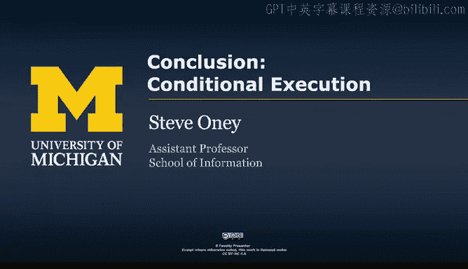

# 密歇根大学《Python3编程（课程1、2）》｜Python 3 Programming（Python for everyone进阶）（中英字幕） - P65：65_03_06_条件执行总结.zh_en - GPT中英字幕课程资源 - BV1CM411Z72u

Great job so far。So in this lesson， we learned about conditional execution。

 which allows us to only run code if certain conditions are met。

Conditional execution is fundamentally important in Python in pretty much every programming language and understanding it raises the ceiling on what you're able to express by a good deal。

But more importantly， now that you understand conditional execution， you'll understand this joke。

A programmer is heading out to the grocery store， and their roommate tells them。

 get a gallon of milk， and if they have eggs， get a dozen。

The programmer returns with 13 gallons of milk。See you next time。

