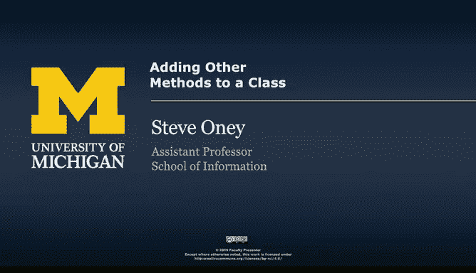
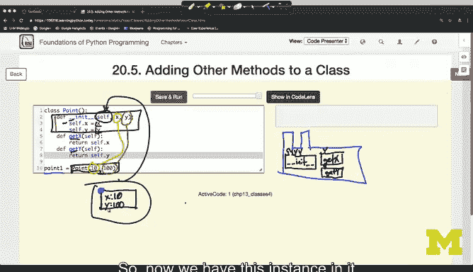

# 密歇根大学《Python3编程（课程3、4、5）》｜Python 3 Programming（Python for everyone进阶）（中英字幕） - P66：09_02_04_为类添加其他方法.zh_en - GPT中英字幕课程资源 - BV1gj41177yd

Welcome back。So last time we talked about creating classes and again。

 the way that you create a class is you say class。And then the name of the class。

 which easily starts with the capital letter。So I'll say class point。

I'm going to leave open and closing parentheses here。And then you usually declare constructor method。

 which is underscore in it。Don' underscore。And every method takes in an argument itself。

And in the case of point， we'll call x and y the arguments of the constructor。

And then we set the instance variables inside of the constructor。

 so I'll say self dot x equals x and self do y equals y。In this lecture。

 I want to give some more detail about what actually happens when we construct an instance of this point class and how Python actually searches for instance variables and methods。

So we construct a new point， I'll say point1 equals point。

And then we need to pass in values for x and y。So I'll say that x is equal to 10 and y is equal to 100 for 0。

1。So let's suppose that we declare two methods。Gett x。Which returns self Dex。And get why。

Which returns self dot y。When we declare these methods。

 what Python does is it has some internal representation of the class itself。

Now we've talked about the metaphor of classes as factories。

 so I'm going to visually represent a class。As this factory like object。

 so you can imagine these as the smokestacks。 and this is the factory。So when we have an in method。

We're saying that we have one method inside of the class called Dco in it。

And this is a function like object that lives within the class。So it accepts three arguments。

 it accepts self。And it accepts arguments for x。And why。So this method in underscore it。

 the constructor lives inside of the class。And then when we have get x。

 this method also lives inside of the class， so we have this method inside of the class， get x。

In this case， it takes in one argument which itself。And then we have the method get y。And again。

 get why lives inside of this class。Now， on line 10， when we create a new instance of point。

 what this is doing is it's asking the class to create a new instance。

 and I'm going to represent this instance。Like Sir。In every instance has a set of instance variables。

 in this case， the instance variables are x。Which we set to 10。And why， which we set to100。Now。

 I want to go into a little more detail as to how exactly we set these instance variables x and y to 10 and 100。

 In other words， what exactly happens when we say point。10，100。

So I'm going to erase this instance for now。And let's start from scratch。

 So when Python evaluates this statement，010100， then what it does。

Is it first creates a new kind of blank slate instance。So it creates a new instance of point。

And it doesn't have any instance variables at first。The next thing that Python does is it asks。

 does this point class have a constructor， In other words。

 this underscoreco in it method In the case of point， there is a underscore in it method。

 So what Python does is it calls that underscoreco in it method on this empty instance。

So what it's going to do is it's going to take this instance and pass it in。As the value for self。

 when we call the constructor and all of this is done before we even have finished evaluating the statement。

So we take this instance in。And that's the value of self。 And then in this case。

 we're also passing in two additional arguments。 We're passing in 104 x。And 100 for y。

And when we're passing in values for x and y， these are just function arguments。So in other words。

 even though x just so happens to be the name of what's going to later on be an instance variable。

 there's nothing special about this value x。So now we're calling the constructor to underscore it。

 and we're passing in our new instance， which is blank。

 and we're passing in again values for x and y。Now， on line 3， when we say self dot x equals x。

 then what that does is it sets the instance variable for this instance。

So it's setting the instance variable x。To whatever this value x that we passed in it。

So in this case， we passed in 10 for x。 So we're setting the instance variable for this instance。

X to 10。Same thing for why in this case we're setting y to the value one hundred0 because that was what was passed in。

So now we have this instance and it has two instance variables x and y。

That's all for now， until next time。