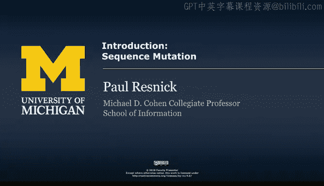

# 密歇根大学《Python3编程（课程1、2）》｜Python 3 Programming（Python for everyone进阶）（中英字幕） - P66：66_04_01_序列可变性导论.zh_en - GPT中英字幕课程资源 - BV1CM411Z72u

Welcome back。Sometimes you'll want to change an object after you've created it。

 You create a list and want to keep adding items on to the end of the list。Create a turtle。

Change its pen color。There are two ways to change the value of an object after you've created it。

 One， you can make a modified copy of the object， and the other is to modify the original。

We'll call that mutation。And it's useful， but sometimes confusing。So today's lesson。

 how mutation of existing objects works。Recognizing the potential confusion that that can cause。

At the end of today's lesson， you should be able to identify whether an object is mutable or immutable。

You should be able to identify whether a method mutates an object or creates a modified copy of it。

And you should be able to recognize when two different variables are aliases for the same object。

And predict whether an operation on one of those variables is going to cause。

An impact on the contents of the other one。