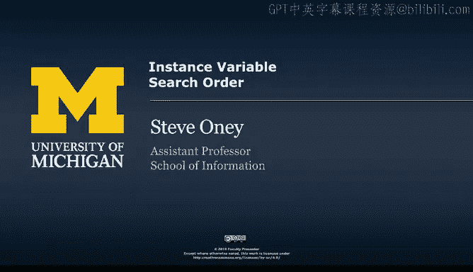
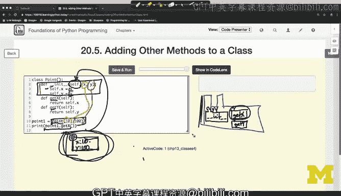

# 密歇根大学《Python3编程（课程3、4、5）》｜Python 3 Programming（Python for everyone进阶）（中英字幕） - P67：10_02_05_实例变量搜索顺序.zh_en - GPT中英字幕课程资源 - BV1gj41177yd

Welcome back。So when Python creates a new instance of point。

 then what it does is it creates an empty instance and then passes that into the constructor。

 which is typically going to set instance variables。

The next thing that you need to understand is how Python searches for instance variables and class methods。

The next thing that you need to understand is the search order that Python uses when searching for instance variables。

 class methods and class variables。So when we say something like print。Ping。1 dot x。

Then the first thing that Python does is it asks， well， is this an instance variable。

 So it looks at this instance01。 in this case， we are representing that instance with this object。

It looks at this instance and asks， does this have an instance variable called x In this case。

 it does。 And when it finds it in the instance， then Python gives us the value of that instance variable。

 So in this case， we're going to get 10。Now， if we searched for something that wasn't in the instance variable。

 So， for instance， let's suppose that we say print。1 dot get x。

hen python first needs to evaluate where is this method point one dot getex。

So the first thing that it searches is01， it asks does point1 have an instance variable called GEX？

But point one doesn't。So the next place that Python searches is it recognizes that point1 is an instance variable of this class point。

So the next place that Python searches is inside of the class itself。In here。

 this is where Python actually finds this method get x。

 So when Python evaluates any instance variable or class variable。

 it first looks inside of the instance。And then it looks inside of the class。

If it doesn't find it inside of the instance or inside of the class。

 then it's going to throw a runtime error。That's all for now， Until next time。

