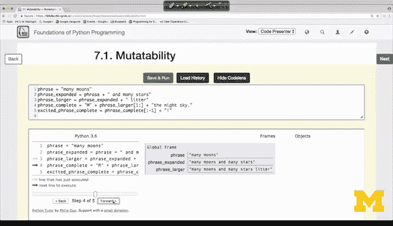

# 密歇根大学《Python3编程（课程1、2）》｜Python 3 Programming（Python for everyone进阶）（中英字幕） - P67：67_04_02_可变性概念.zh_en - GPT中英字幕课程资源 - BV1CM411Z72u

Ls are mutable。 You can change them。You can reassign the contents at any position to be a different value。

So in this example， we're setting fruit。I's a variable to have the value banana， apple cherry。

 and then we're going to change it so that the first item isn in banana and it's pear instead。

Let's go through this。Align at a time and draw out the reference diagram。A mind1。

We create a variable fruit。And assign it to a list with three items。We have banana。We have Apple。

And we've got cherrry。If we print it out， we'll get banana， apple and cherry。

Then we'll get to line 4。Where we're going to change。The value in one of these positions。

Now you've previously seen indexing into this。Let's have physicians like zero，1， and2。

And so fruit square bracket0 is referring to this position。That currently has banana。On line 4。

 we're not just referring to fruitru square bracket 0。

We are changing the value of fruit square bracket 0。

 We are making fruit square bracket 0 equal to a new value。So， that has the effect of。

Replacing the old value。With a new one， we cross out banana。And we add a new value。Pair。😔。

Then we get to line 5。Where we're going to make another replacement。In this case。

 we're replacing a position -1， just as we did for looking up values in a list。By position 0，1，2。

 or from the end， position -1， position -2， position -3。We can。Assigned to those positions。

 So fruit square bracket -1 equals something that's going to cause us to cross out。

 replace the current value。That's there with a new value。In this case， orange。

So let's try running this。The first time something is printed， we have the original values。Of banana。

 apple， and cherry。Then we made our two substitutions。And then we printed something else。

 We printed the new value of fruit， which had pear， apple and orange。

Instead of just replacing a single item， we can replace the items at a particular slice using the same slice notation we look used for looking up items。

 We can use that to find a place where we want to do a replacement。

So let's look at this one in code lens。The first line， when we execute it。

 creates a variable called a list。A list has has its value。 this list of five or six items。A， B，C， D。

 E， and F。And line 2 is going to mutate to destructively modify this list。Now。

 remember that when we use the slice notation， we're referring to a sub sequenceence。Of the list。

And we begin at position 1。And we go up to， but not including。Position 3。

So this is a slice that's two items long， and we're going to replace those。

Get rid of that whole slice。We're going to add in。Two new items there。X。And why。

So now when we print it out。Let's just see then， the net effect of that。Clear our notations。

We've now replaced。The items that position with1 and 2 with x and Y。And if I print it。I now get A X。

 Y， D， E， F， instead of A， B C， D， E， F。And werere not required。To have the things that we。

Add in be of the same length as the things that are being replaced。

Here's an example showing how we can actually。Use this reassignment to delete items。So in this case。

We first assign a list to have the values ABC DE。And F。We're going to start at position 1。

Go up to position3。But not including position 3。 And we're going to delete those items and replace them。

With the empty list。So we're going to replace them with all of the items that are in。This empty list。

 which is nothing， so we're really going to just get A， D， E， and F。Sure enough when I go forward。

I get。A， D， E and F。Ls are mutable。 Strings are it。We could reassign to position 0 in a list。

 We cannot reassign to position 0 in a string。So for example， if I run this code。

 I set the variable greeting to be a string。And then， I。Try to change the thing at position 0。

Just analogous to what we were doing before。We had。Reading。boundund。😔，To this string。

So we have greeting bound of that string in position zero。We've got that H。

And you might think that we could just replace the H with a J。But we can't do that。

 That is not permitted， and we get this error message。We get a message saying。Type string。

Does not support item assignment。 We can't reassign a value within a string。Now。

 suppose we really did want to take our Hello world string and turn it into Jeello world。

How could we do that， We can't reassign at position 0。 That's what we found out just a moment ago。

 So how do we do it。But we can take the string Hello world。

 and we can make a new string that has some of Hello world。😊，But， a little bit different。

In particular， we're going to take that hello world。And we're going to。Start at。Position。

 so this is position 0， position 1，2，3， and so on。We're going to start at one。

And go all the way to the end。That's what it tells us when we say， greeting。Square bracket，1 colon。

Reading is the name of our variable。And we're going to start at position 1。

 That's with the letter E and go all the way to the end because we don't have anything after the colon。

 that means keep going all the way to the end of the sequence。So that gives us LO world。

And if we take。Eello world。Concatenate that on。Jy。We get jello world。there we have。Gello world。 Now。

 notice on line 4， it says print greeting。Greeting。Is still hello world。

So that's why we get this is our second line。New greeting。Was bound to our new stringing jello world。

 And that's why。We get this printed out。So you can't change the original string， hellello world。

But you can make a new string using a lot of the letters from Hello world and just concatenating them on a new first letter。

Here's an example of concatenating together a bigger string from parts。

Let's show this one in code lens。We first start with。A small phrase， many moons。

We want to expand that so we define a new string。That has many moons， plus some more letters。

So we still have。The old variable phrase。But we have an additional variable now called phrase expanded。

And we can keep doing that。 We can make it even longer。 That's what's going to happen in step three。

So phrase larger is yet a longer string， notice that the previous variables are still bound to their original values。

And then finally， we're going to replace that small M with a capital M。

So you'll be assembling。Longer strings from shorter strings in this way。

 And itll let you put variables in in the middle of your strings to generate slightly different strings each time。

