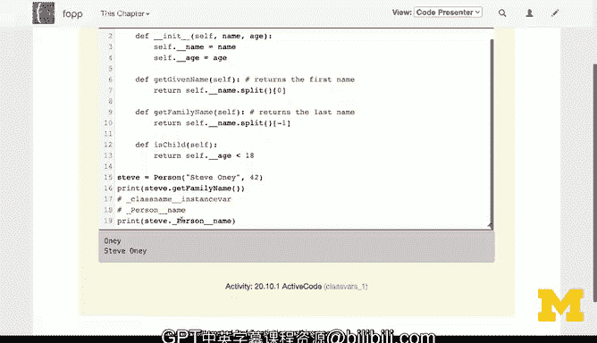

# 密歇根大学《Python3编程（课程3、4、5）》｜Python 3 Programming（Python for everyone进阶）（中英字幕） - P68：11_02_06_私有与公有实例变量.zh_en - GPT中英字幕课程资源 - BV1gj41177yd

Welcome back。Let's look at this code that defines a class to represent a person。Within this code。

 we have a constructor that accepts two arguments for name and age。

 and it sets two instance variables also called name and age。

And we have three methods as part of our person class。

 one for getting someone's first name or given name， one forgetting their last name or family name。

 and one for returning if they're a child or not， and we're just going to say that anyone under 18 years old is considered a child for this application。

So we can create an instance of our person class here。And we can call methods on that instance。

 so if I sayP Steve， get family name。Then we should get OI。Now。

 one thing I want to note here is that these instance variables。

 name and age can be accessed from both within this class definition。

But also outside of the class definition。So。😊，I could print。Steve dot name。

And this would get the name associated with the instance， Steve。

Now this might not seem like a problem， but here's the thing in programming we often collaborate with other programmers。

 we might be explicitly collaborating with other programmers。

 like when we're part of a team or maybe we're implicitly collaborating with other programmers like someone's downloading our code and importing it into their own codeb。

Now， when we do this， the other person using our code shouldn't have to worry about the implementation details of our code。

 so they shouldn't have to worry about things like exactly what we called these instance variables。

Or they shouldn't need to worry about exactly how we store the name so for example。

 maybe I decide to split the name in the constructor and say self do first name equals。

This expression。Inse。That last name equals。This expression。And if I did this。

 then I might return self dot first name here in self dot。Last name here。And if I do this。

 you'll see that the code that I wrote that depended on the instance variable named name is no longer going to work。

So other programmers shouldn't need to know exactly how I implemented my class。

 they should just be able to call the methods that I defined， get given name， get family name。

 and is child， and get the correct results and ideally I should be able to change my implementation details of the person class without breaking any code that uses it so this is analogous to the fact that you don't need to know exactly how the internals of any of the other classes that you use in Python work so you don't need to know the internals of how turtles are represented or strings are represented or requests work you should just be able to use the publicfa interface for all of these classes。

But the problem is that if another person is using this person class。

 they can access or modify all of the instance variables like name， age， first name， last name， etc。

So what can we do about this？If I go back to my old code。

There are two ways of specifying that instance variables should be considered private。

 and what that means is that you're saying that an instance variable shouldn't be referred to directly。

 so if I wanted to signal within my person class that the name instance variable should be considered private。

 then the first way that I could do this is by renaming it to start with an underscore。没是。

So if I change all of the references to self。t name to self。t underscore name。

Then my code is still going to work。But what the underscore does is it sends kind of a social signal and what this tells another programmer is that you should not depend on this code。

Now there's no way in Python to make an instance variable completely private， so in this case。

 another programmer could still reference Steve dot underscore name and get the full name。

 but what this underscore does is it sends a signal that you shouldn't depend on this instance variable so you shouldn't reference it or you shouldn't assign it。

Another approach that I could take is I could start my instance variables with double underscore。

 so I could say Steve。 double underscore or underscore name in Steve。 underscore age。

And I can change the rest of my code appropriately as well。Now。

 if I start my instance variables with two underscores。

 this also sends a signal to other programmers that they should not reference or modify these instance variables。

But what Python also does with instance variables that start with two underscores is it mangleles the instance variable name outside of the class definition。

So here， all of my methods are going to work properly， but now if I try to print out Steve。

dunderco name。I'm actually going to get a reference here saying that a person object has no attribute underscore name。

And that's because when instance variable starts out with two underscores。

 what Python does is it automatically mangleles that instance variable name outside of the class definition and the way that it mangleles it is。

😊，It kind of remaps it to an instance variable。Named underscore， and then the class name。

And then two underscores。And then the instance variable name。嗯。So in the case of name。

 then this would be。Underscore person。Double underscore name。So outside of the class。

 I can still technically refer to the name instance variable by writing it this way。

But when I start instance variables with two underscores， then one。

 it helps to prevent accidental overwrites and references to instance variables by mangling the names of those instance variables。

 and it also sends a strong signal to other programmers that they absolutely should not reference or modify these instance variables outside of the class definition。

That's all for now until next time。

