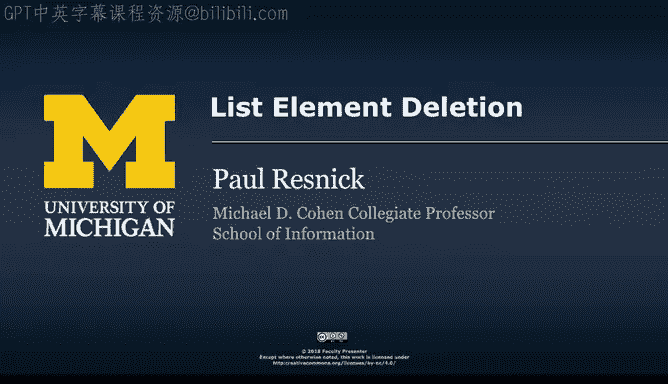
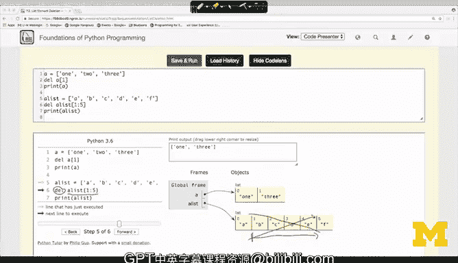

# 密歇根大学《Python3编程（课程1、2）》｜Python 3 Programming（Python for everyone进阶）（中英字幕） - P68：68_04_03_列表元素删除.zh_en - GPT中英字幕课程资源 - BV1CM411Z72u

It's awkward and error prone to use。Slicing to delete things out of a list。

 So Python gives us a special operator to do that。 It's called the delete operator， D， E， L。😊。

In this case， in this code， we're creating a list called A。With three items in it，1，2， and 3。

And then we're calling the Dew operator to remove item 1。So let's see this in code lens。

We first create the list。And then a square bracket 1。Refers to this position。And when we delete it。

The value 3 is now going to move up into position one。

 and we'll end up with just one and3 in our list。Now we've just got one and three。

And we can not just delete a single item。 We can delete a whole sequence of items。

Here we have a list。AB，C， D， E， and F。We're going to start at position 1。Go all the way up to。

 but not including position 5。Thus a list。Square bracket，1， Col 5。And that's all going to be deleted。

 so。We do that， and we're left with just A and F。

