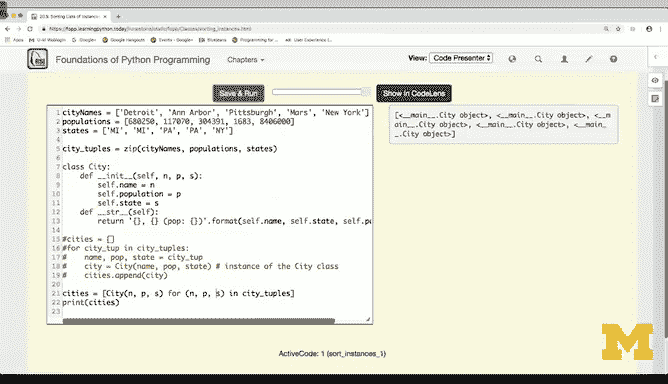

# 密歇根大学《Python3编程（课程3、4、5）》｜Python 3 Programming（Python for everyone进阶）（中英字幕） - P69：12_02_07_示例：从数据创建实例.zh_en - GPT中英字幕课程资源 - BV1gj41177yd

Welcome back。 So suppose that we have some data， and we want to use classes to represent that data。

 So that data might come from a file。 It might come from an internet source。

 or in the case that I'm going to go through right now。

 it might come from something that we just hard coded。 So in this case， I have a list of city names。

 populations and states。 So I have city name， Detroit with population 680250 in state， Michigan。

And I have Ann Arbor。Population 117070， state， Michigan， et cetera。 So Pittsburgh。

 this is the population。 State is P A， Mars， small population in Pennsylvania， New York。

 large population in New York。So let's that I have this data and let's suppose that I also zip this data together。

 so zipip is going to take these separate lists and create a list of tuples so if I print out what's the value of city tuples。

I'm going to see that I have a list of tuples where every city name is coupled with its population。

 which is coupled with the state。So suppose that I want to use classes to represent this data。

The first thing that I would ask is what data do I want to be able to put into every instance。

 so what should every instance have？So what should。Instances。Store。So in this case。

 let's suppose that I care about all three of these things。

So let's suppose that I care about the city name， the population and the state。

 So I want every instance to store the city name。Population。And state。

Then I would ask what do I want every class to represent In this case。

 it's a little bit obvious every instance should represent an individual city and every individual city is going to have a name。

 population and state。And I'm going to call my class city， so let's define our city class。

I'll do that by saying class capital C city。And in the constructor。I'm going to accept a name。

 population and state， and I'm going to set instance variables， so self dot name equals N。

 self dot population equals P， self do state equals S。

And let's suppose that I want to have a STR method， so to underscore STR。And I want it to return。

The city name。State， and then。Population。So I'll do this dot format， self dot name， self dot state。

 self dot pop。Okay。So now that I have this list of city tuples and I have a class to represent every individual city。

 I want to take this list of city tuples and create a list of cities。

 So let's suppose that I want to have a list of cities， So I'll say cities。

 I'm going to start it out as an empty list。 Then I'm going to loop over every tuple。

 So I'll say four city tuple。In city， tuples。For now。

 I'll just print out what's the value of city topple。

And I can see that I get every tuple on a separate line。If I wanted to， I could set name， population。

 state equal to city Tple。If I print these out。Name， population and state。

And I'll see I have the city name， population and state in different variables。

If I want to create a new city with that name population and state， I'll say city equals a new city。

With name， population and state。And now， city is an instance。Of the city class。So if I print out。

 what's the value of city？Oops。And I also need to。Do you spell out population in my STR method。Okay。

So now I'll see that I am actually calling this underscore STR method on my list of cities。

If I wanted to add that city to my list of cities， I could say cities。That append city。

And by the end of this four loop cities。Is going to be a list of city instances。

 so I can say print cities。And you can see， I have a list of city instances。

So some shorter ways of doing this。One thing that I could do is I could use list comprehension。

 so rather than having all of these lines。I could use this comprehension to say that cities equals。

A new city with name， population and state。For every name， population and state。In city tuples。Now。

 if I do this and I actually print out cities。Then I'll see that I get a list of city instances as well。

 One really short way of doing this is actually， if I。Do you tea。I can actually add this star T。

 What star does is it takes this tuple and expands it into a list of arguments。

 So this constructs the same thing I'm going to prefer， however。

To instead explicitly get out the name， population and state。

That's all for now until next time。