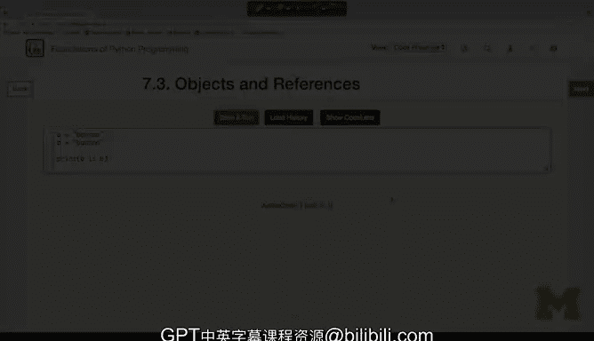
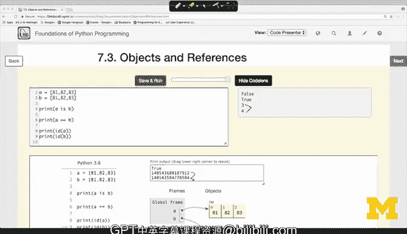

# 密歇根大学《Python3编程（课程1、2）》｜Python 3 Programming（Python for everyone进阶）（中英字幕） - P69：69_04_04_对象与引用.zh_en - GPT中英字幕课程资源 - BV1CM411Z72u

When we have two variable names that point to the same value， things can start to get confusing。

It's actually not too bad when we point to immutable objects。So， for example。We have the variable， a。

Pointing to。Banana。And we've got B。Also， pointing。To banana。Now， it turns out that with strings。

The Python interpreter figures out。bed。😔，It's the same string banana。

 and it makes A and B both point to it。And so we have this operator is。

Which checks and tells us whether A and B are pointing to the same object。

 Are they aliases for the same object。And here it says true， A and B are pointing to the same object。

It's going to get a little more complicated for us when we start dealing with lists and other mutable objects。

Here we've got variables A and B， both pointing to lists that have equivalent values。But。

 it turns out。They aren't actually aliases for each other。 Let's see this。 in code lens。So。

 the variable A。Is bound to a list of three items。81，82， and 83。

Then we're going to assign B to a list that's really equivalent。But it isn't the same list。

So we end up with two lists that each have the values 81，82 and 83 in them A is not an alias for B。

 So when we print A is B， it tells us。False。However， if we ask， does a equal equal B。

As we do on line6。It'll tell us true。So equal， equal as an operator， the checks weather。

Two variables are bound to objects that are equivalent to each other。A is B。

 checks whether A and B are aliases for exactly the same object。If we print the IDs。Of these。

 two will see that they are not the same。So those are very long IDs。

I just want to point out one other thing。Which is that if we。Run this， not in code lens， but in the。

Active code window。We get。The same answer is false and true for whether a is B and whether a equal equals B。

But the I D numbers are a little different。In code lens。

 the interpreter is running off on some remote computer。

 and it's got a real Python interpreter where the ID numbers are really big。

When we run it in the active code window， it's doing something right in the browser。

 it's the only thing running so it ends up with these small ID numbers。

 but the important thing to notice whether you run it in the active code window or whether you run it in code lenss is that the two ID numbers are not the same。

Three and four are different， or these two ID numbers are different。

You probably won't have much use for the Is operator or printing the IDs of objects。

 except maybe when you're debugging things。But they're very useful for helping you understand whether you're dealing with two references to the same object or whether you are dealing with two copies of the object。

