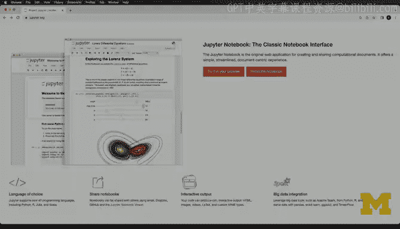
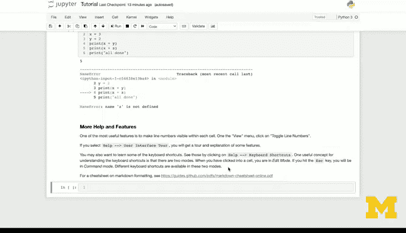

# 密歇根大学《Python3编程（课程3、4、5）》｜Python 3 Programming（Python for everyone进阶）（中英字幕） - P6：05_01_07_在Jupyter环境中执行Python.zh_en - GPT中英字幕课程资源 - BV1gj41177yd

I'm excited to introduce you now to a new execution environment。

 a new way to execute Python code called Jupiter。 Coursera has a way for you to run Jupiter notebooks without installing any extra software on your computer。

 We've provided a bunch of notebooks， called Labs。😊，It's optional to go through them。

 but may be pretty useful to reinforce things you've learned。

These labs were originally created for an on campus course where students went through the notebooks together at in person lab sessions with instructors present。

You may find some of the questions posed in the notebooks to be pretty challenging on your own。

 so I encourage you to use the Coursera forums to discuss the questions with your peers。

Maybe you can even find a study buddy for synchronous sessions where you work through the notebooks together。

The end of week assessments and end of course， larger project will also be Jupiter notebooks。

 so even if you don't do the optional labs， you'll be using Jupyter notebooks in this course。

This video will walk you through a notebook that introduces you to the Jupiter environment。

Feel free to follow along with me in your own copy of this as I show you some things。To do that。

 find the lab activity following this video titled Lab Mechanics usingsing Jupiter Notebooks。

The notebook is divided up into cells。There are two types of cells， markdown cells， and code cells。

A markdown cell like this one at the top。Lets yougene formatted text can have things like bullet lists and bold face。

We'll look at how to write this formatted text in a minute。The other kind of cell is a code cell。

Like this one。If you click in a code cell。And then you click the Run button。

It runs the code in that cell。It's kind of like an active code window in Runestone。

 but there are a couple things that are different about code cells in a Jupyter notebook from active code windows in Runestone。

The first is if the last line of code in the cell is an expression like this x plus 1。

When we execute the cell， when we run it。We get an output。In Runestone。

 you would only get to see that an output。 if you had an explicit print statement。

I'll show you that you can also use the print statement in in Jupiter。 So in this cell。Yeah。

I've got both print statements。And an expression at the end。And when I go to run it。

After clicking the cell before I click Run。I will get both the outputs of the print statements。

 So this print X that first one gave me 9。Printing x plus1 gave me 10， and the expression x plus 2。

Did not have a print statement， so it shows as the output of the cell。

A second important difference between running code in cells in Jupiter versus running them in runestone。

Is that the variable bindings are preserved between cells。When we ran the cell above， X。

Got a binding of 9。If I then go to another cell。And I just ask for x plus 10。

 it looks up the value of x。Even though we did not assign a value to X in this cell。

If you remember in the Runonestone textbook， every active code window was its own。

 It didn't remember any variable bindings from any other windows that you might have executed。

So if I run this。It gives me 19。I can insert another code cell below this one。In this cell。

 I can set x equals 100。I can run that。And that will change。The variable binding。

X no longer has the value 9， it has the value 100。If I come back to this cell。And execute it again。

 it's going to get the new variable binding。So， now。It prints out 110。Mostly。

 you'll really appreciate this persistence of variable bindings between cell executions。

But if you execute things out of order， you may forget that you did that and you might get some confusing results。

The notebook tries to help you by numbering the outputs of cells。

 that tells you the order in which the cells were executed。 For example， in this case。

We can see that in between the execution of the cell above and this cell。

 the cell below was executed。 We can tell that， because。This has a one。Saying that was executed。

Then we got it two， this one is a5， and this one is a4。

 so we know that this cell executed before this cell did because four is less than five。

That can sometimes help。 but if you ever get really confused。

 you can always just clear all of the outputs and throw away all of the variable bindings and start over from the top of the notebook。

To do that。You click on kernel restart。Restar and clear output， so that's going to get rid of。

All of the outputs of all of the cells。So now we have a clean version。

 and we can go through the cells one by one。And run them。In order。

And not be confused about any of the variable bindings。Okay。

Here we get the 19 that we're expecting at this point in the execution。

Jupiter automatically saves your notebook at various points， so it's auto saving。

But if you ever want to， you can save explicitly， there's a couple ways to do that。

One is that you can save in checkpoint。And then you can revert to a checkpoint。

In some other environments I' found that it normally would save several checkpoints for you and you can go back to different checkpoints in Coursera。

 it seems to only save one checkpoint， so you might want to do a different kind of save where you actually save as and you give your notebook a specific name and then there'll be a way to go find that notebook again。

Most of the time， though， you'll be happy to just have the latest version that Jupiter is auto saving for you。

The Python interpreter for the Jupiter notebook is a little different than the one in Moonestone。

It's actually the official Python interpreter。 That's mostly a good thing for you。

 but you'll have to get used to the error messages。In Runestone。

 the error messages were translated to be a little bit more friendly to novice programmers。

In Jupiter， you get the original error messages， for example。

 let's see what happens get when we run this。Okay。We actually get an output of five。

That's coming from this print statement， But then when it tries to execute this print X plus Z。

 Z doesn't have a binding。So we get an error message。And it tells us。That there was a name error。

 that's the kind of error。And it says Z was not defined。

 it also shows us the whole code context that the problem happened on line 4。

I think you'll get used to interpreting these pretty well。One thing I find quite helpful。

Is to turn on line numbering。And when you first open the Jupiter notebook。

 you might now have line numbering turned on if you go to the view menu。Tggle line numbers。

And magically， we have line numbers。And that can be helpful because we know that it was supposed to be line4。

 There was a problem we can easily find line 4 here and realize that's where we had a problem with the variable Z。

 Now， let me tell you a little bit about these mark down features。

We can have comments in code cells just like you can anywhere with Python。

But now we have something else we can do。 We have these nicely formatted cells。Like this one。

If you double click on it， you can see the formatting language that is used for。

For specifying how to get this， it's called Markdown。If I put a sharp。

Or pound sign at the beginning of a line。It makes it big font。If I do multiple of these。

 it's a third level header instead of a first level header， which is it's a little bit smaller。

 So I click run and I get to see how it's nicely formatted。

 I double click in it and I see the original markdown behind it。There's other other nice things like。

Inclosing some text in the back quotes， makes the text be highlighted。Think you see here。

If I want to get this italics。I'm going to enclose it in star。So star edit mode。

That makes it be italics。When you put in a URL， it'll automatically come out as a link。

Like this and this particular link is a nice link to a cheat sheet of lots of other useful things that we have in Markdown。

I encourage you to explore more， including following that link。

I have found it helpful to learn a bunch of keyboard shortcuts for this video。

 I've clicked on menus and clicked on the run button。

 so it would be clearer to viewers what I was doing。 But when I use Jupiter notebooks normally。

 I do most operations using keyboard shortcuts。😊，I hope that you'll enjoy creating and using Jupiter notebooks。

 They're really perfect for the size of programs that you'll be creating in the rest of this course and others in this specialization。

😊，For even larger programs， you'd want to use a different development and execution environment。

 one where you put a whole bunch of code in a file and the entire file gets executed at once。

 than they call an IDE， an integrated development environment， something like pie charmm or B S code。

And you'll get a brief introduction to those kind of IDEs later in the specialization。

I'll see you next time。