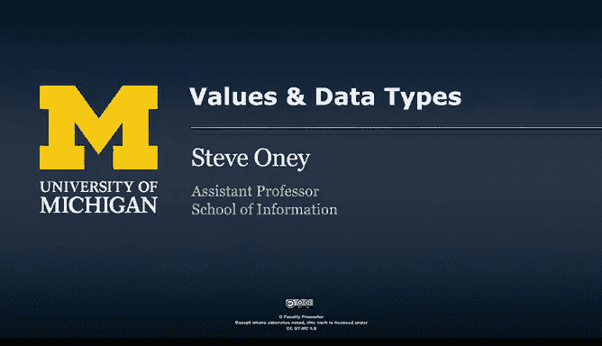
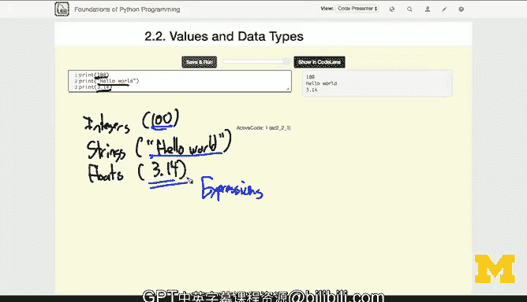

# 密歇根大学《Python3编程（课程1、2）》｜Python 3 Programming（Python for everyone进阶）（中英字幕） - P6：06_01_02_值与数据类型.zh_en - GPT中英字幕课程资源 - BV1CM411Z72u

In this lesson， we're going to go over some of the basics of writing Python programs。

 part of the reason that I really like Python as a first language is that it doesn't take much to actually write a simple Python program。

So when we write a Python program， we are going to write our Python code。In this window。

And the code that we write is going to go into a Python。Interpreter。

Which is a program that's running behind the scenes。

 but it takes what we write in our code window and interprets it。And then depending on what we write。

 it might send something to the output。 So again， this is the source code。This is the output。

And the python interpreter looks at our source code。

So we've already seen a Hello World Python program。

 but I'm going to write a program that's even simpler。This is a valid Python program。

So if I click saveve and Run， then you aren't going to actually see anything in the output program。

 but Python did actually interpret and run this program correctly。

 so remember that there's this hidden Python interpreter and when we actually ran this code。

 the Python interpreter looked at our source code ran it and just saw that there was no output for it。

So when we write code， we're actually writing what are called expressions。

Learning to program is in part learning the right expression to write for what we actually want to compute。

So 100 is an expression。And when we write expressions。

 what the Python interpreter does is it computes the value of those expressions。

So we have expressions。 Every expression has a value。So in the case of the expression，100。

The value of the expression 100 is just100。And then every value also has what's called a type。

A type is like a category of data， so the type of 100 is an integer。

An integer is just a round number。So I'm going to add on to this program。

By writing another expression。So here's another expression，3。14。Again， when I run my program。

 nothing shows up， but what's happening is that behind the scenes。

 the Python interpreter is looking at my code and deciding what to output。

So here we have two expressions。The first expression is 100。 The second expression is 3。14。

 Both of these expressions have a value。 So the value。Of 100 is 100。The value of 3。14 is 3。14。

And both of those values have types。So the type of 100 is an integer。The type of 3。14。

 because it has a decimal place is something called a float short for floating point number。

So we can write expressions that compute all of the values that we want。

 and Python will do these computations behind the scenes again with this Python interpreter。

But typically we want our programs to actually give us some feedback。

 we want it to do something and then give us back some value in the output window。In other words。

 we don't just want our source code to go back to the Python interpreter and get no output。

 we usually want some output or some feedback from our programs。In order to do that。

 we need to use something called the print function。

 We can think of print as a special expression that tells something to show up in our output window when we call it。

😊，So I'm going to modify my source code to say rather than just computing the value。

To also print out the value。And the way that I do that is I say print。Open parentheses。

And then the value of whatever expression I want to print out and then close parentheses。

So if I only say print 100 and I run my program。Then I'll see that in my output window。

 I get 100 because I specified that I want to print out the value of this expression。

So notice here that print 100 prints out 100， but when I say just the expression 3。14。

 then this doesn't lead to any output。In order to actually print out the value of this expression。

 I need to call the print function here。And now when I run my code。

 then you'll see that the value of both of these expressions is printed。So so far。

 we've seen two kinds of types。 we've seen integers， which are round numbers like 100。In floats。

 which are decimal point numbers， like 3。14。Another type that we've actually seen in an earlier lecture was a string。

 So when we said print。Hello， world。Then this expression， hello world。Is this string。

A string is a sequence of characters。 And if I run this program。

hen you'll see that hello world is what actually gets printed out when I run line， too。So so far。

 we've seen the types integers。Like，1 hundred0。Strings。Like hello， world。In floats。

short fur floating point number。Like 3。14。And in all of these cases， these 100。

 the string hellello world or 3。14 are all expressions。Now。

 expressions are like the building blocks of programming。

 we can combine and reuse expressions to get more and more complicated programs。

So the expressions that we've written so far are what are called literal expressions。

 where the value is the same as the expression itself， so the value of the expression 100 is 100。

 the value of the expression 3。14 is 3。14。 Let's move on to operators to see how we can combine expressions to get more complicated expressions。

