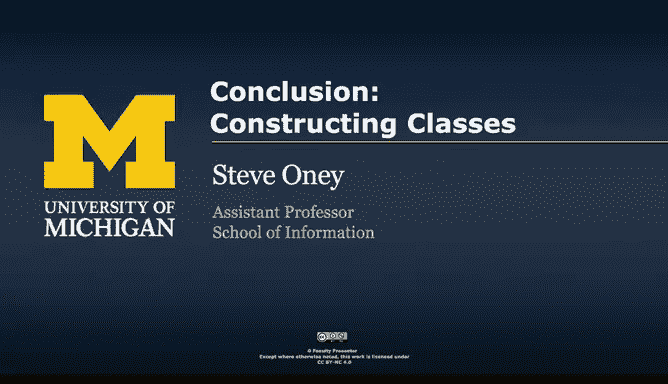

# 密歇根大学《Python3编程（课程3、4、5）》｜Python 3 Programming（Python for everyone进阶）（中英字幕） - P70：13_02_08_小结：类的构建.zh_en - GPT中英字幕课程资源 - BV1gj41177yd

To recap in this lesson we learned about classes， and the basic idea of classes is that we can write code that encapsulates relevant data and functions into individual objects that we can then reference and manipulate a technique that's sometimes called object oriented programming。

For many applications， as a result of this， we can write cleaner code and we will give more examples of this in the lessons to come。

Now， as you can tell， Python functions and methods are very similar。

Functions and methods are both callable objects that you can invoke with arguments。

They both return a value。 You define them both with de， et cetera。

 But the difference between functions and methods is that methods are defined within a class and are associated with instances of that class。

 whereas functions live outside of any individual instance or object。

But bear with me for a bit and picture a function personified named Frank and a method named Mary。

You might be surprised to find out that despite all of their similarities。

 the function Frankra and the method Mary don't actually get along very well。

 And if you ask the function franc why he'd say that it's because methods are very selfish。

 They always put their self first。See you next lesson。

