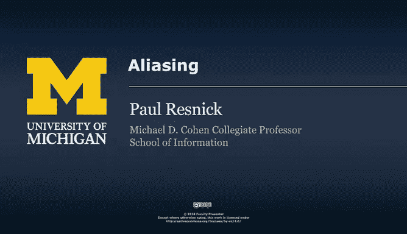
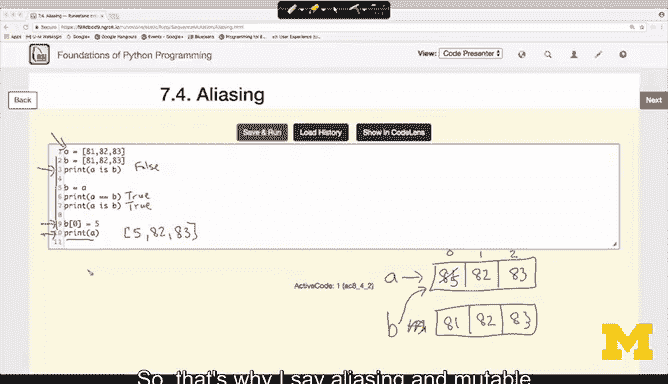
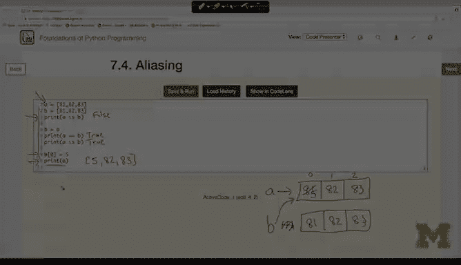

# 密歇根大学《Python3编程（课程1、2）》｜Python 3 Programming（Python for everyone进阶）（中英字幕） - P70：70_04_05_别名现象.zh_en - GPT中英字幕课程资源 - BV1CM411Z72u

So you might wonder why are we making such big deal out of whether A and B point to the same object or two objects that are equivalent。

The answer is that when they are aliases for each other， when they point to the same object。

 things can get pretty confusing because when you change one of the objects。

 you've changed the other one， too。So let's just see how that works out。On line 1 to the variable a。

Is bound to the list。81，82，83。And B is bound to an equivalent list。But not the same one。

So when we get to line three and it says print A is B， the answer is。False。😔，Now， on line 5。

 we're going make B And A be aliases for each other。 They weren't before， but now they are。

So B is no longer going to be bound to that one。It's going to be bound to the thing that A is bound to。

Now。😔，A is equivalent to be。But we also have it。A and B are bound to the very same object。

If we then set。B square bracket，0 to equal 5。Well， this is position 0， position 1， position 2。

If we set B square bracket 0。To now have the value 5。And then， we go。To print。A。We're going to get。5。

😔，82。83。The reason I say this is confusing is if you look at this code。From the top to the bottom。

We set a to B，81，82， and 83。We never change。 a again。There's no。

There's no assignment statement to A anywhere in here。And then we go print it。And it's different。Now。

 in this code。A and B， they're all pretty close to each other。 We can figure out what's going on。

 but you can imagine a much bigger program where you have a variable and somewhere else in the code。

 some other alias for that variable causes the item to be mutated to change。

 and you have no idea why it's happening。So that's why I say aliasing。

And mutable objects can create some confusions。

Be on the lookout for that。See you next time。

