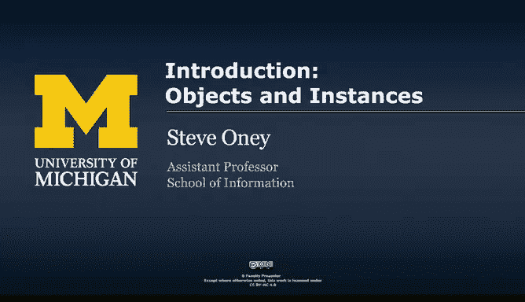

# 密歇根大学《Python3编程（课程3、4、5）》｜Python 3 Programming（Python for everyone进阶）（中英字幕） - P71：14_02_01_引言：对象与实例.zh_en - GPT中英字幕课程资源 - BV1gj41177yd

Welcome back。In the last lesson， you learned how to create classes and instances。In this lesson。

 we're going to go into more depth on how we might use classes and instances as part of larger Python programs。

How to declare useful classes and how to better design code that takes advantage of the features of classes and instances。

We'll introduce additional underscoreco methods like underscoreco STR。

 which specifies how an instance should be printed if we call the print function on it。

By the end of this lesson， youll have solidified your understanding of classes and instances。

You'll be able to reason about how to use object oriented design to solve problems。

 and although it can be difficult to wrap your mind around object oriented programming at first and it tends to take plenty of practice both within and outside of this course。

 my hope is that by the end of this lesson， you'll have a solid foundation to build on So let's get started。

