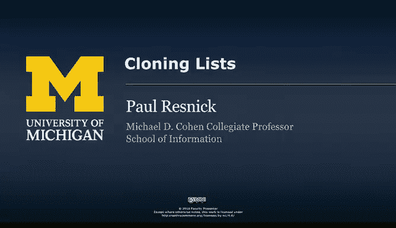
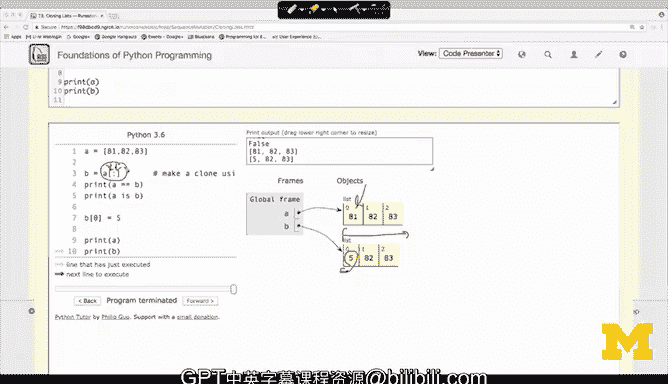

# 密歇根大学《Python3编程（课程1、2）》｜Python 3 Programming（Python for everyone进阶）（中英字幕） - P71：71_04_06_列表克隆.zh_en - GPT中英字幕课程资源 - BV1CM411Z72u

Let's suppose you want to make a clone of a list。Not an alias for it。

 You want another variable that will have。An equivalent list。

 a copy of the original list or a clone of the original list。

 But you want the two lists to be independent。So， we start。Let's say， we start with。

A list A that has the elements 81，82 and 83。 we want to make a new variable B that has a clone or a copy of it。

We can do that using the slice operator， the slice operator。Always。

Gras some part of a list and makes a new list using those items that have been grabbed。

 using the slice。So， if we。If we execute this in code lens， we can see what happens。

So we created a list A。We make a slice。In this case， our slice begins at the beginning of the list。

And goes all the way to the end of the list。So we get all three items 0，1 and 2。

 and they are copied into a new list。And so， we get。A new list。 So B is now not an alias for a。

B is referring to a list with equivalent contents， the same contents。So if we print。A equal equals B。

They are equivalent， that's true。But a is not B。 They are pointing to different lists。Now。

 if I change B sub 0 to be 5。Unlike our previous example。Where B was an alias for A。

 when B sub0 is set to 5， only B is going to be affected。So， we see。Then it has a new value 5。But。

The 81 is still there for a0。So when I print a。I'll get the original list。Be。

Was originally an equivalent list with the same contents， a clone of A， they've become independent。

 and B gets mutated without having any effect on A。There you have it。Clonnal list。

By using the slice operator。If you don't say。Either a beginning or an ending index。

 you get the whole list。And。😔，You get a clone or a copy of the list。

