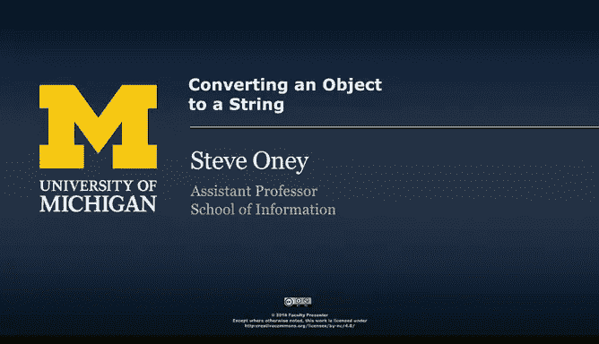
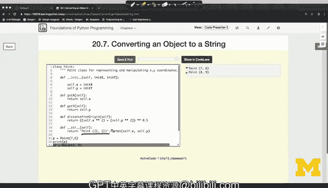

# 密歇根大学《Python3编程（课程3、4、5）》｜Python 3 Programming（Python for everyone进阶）（中英字幕） - P72：15_02_02_将对象转换为字符串.zh_en - GPT中英字幕课程资源 - BV1gj41177yd

Welcome back。So let's suppose that we declare this class to represent a point on an XY plane。

 so again， our class is called point。We have a constructor that takes an argument for x for y and assigns two instance variables。

 x and y to whatever is passed into the constructor。Here。

 we also have methods that get the x value and get the y value。

And we have an additional method that determines the distance from the origin。 So this is。

If the point is at x and y， it's going to get this distance from the origin and return it as a float。

So let's suppose that we create a point at7 and6 if we print out what is the value of this point。

 so I say print P。Then Python gives us back just information saying that this is a point object。

 It has no information about where the point actually is。 So， for example。

 if I had a second point at 8。And。9ine。And printed out P2。

i have no way of telling that P and p two are different points。

So classes can have an optional method called Dunderco STR， so de。Thundercore， STR， Tunderco。

And just like every other method， it accepts self as the first argument。

And what this underscoreco STR method does is it tells Python how to represent that object when you actually print it out。

So if I specify that SDR should print out just point by returning the string point。

now when i print out both of my point instances you can see that i get point，If I instead print out。

Po123， Then I'm going to print out 0。123。So whatever gets returned by this Dco STR method is what gets printed out when we convert this point object to a string in order to print it。

So for points， we might want to have something like point and then maybe the x and y position。

 So what I might say is point。At。X and y， by saying point。That format。And self dot X， self dot y。Now。

 when I print out point p， then I'm going to get point at seven and six because here。

7even get substituted for self do x。6 gets substituted for self dot y。

 and self dot x goes into the first slot。 Self dot y goes into the second slot。

And so now I can tell both of these points apart， and when I print out the instance。

 then I actually get something useful for a point。So when you create a class。

 you often want to set the underscore STR method in order to get more readable and understandable things to print out when you actually print out any particular instance。

That's all for now， until next time。

