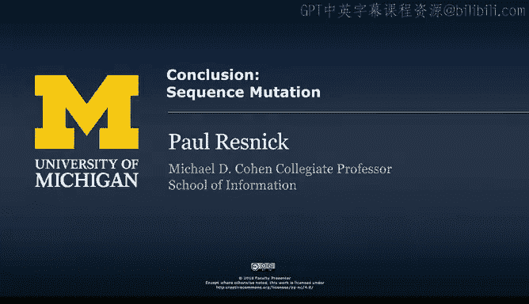

# 密歇根大学《Python3编程（课程1、2）》｜Python 3 Programming（Python for everyone进阶）（中英字幕） - P72：72_04_07_序列可变性总结.zh_en - GPT中英字幕课程资源 - BV1CM411Z72u

That's the basics of object mutability。 You should now be able to identify whether an object is mutable or not。

Les are mututable Pes and strings， not。You should be able to recognize when two variables are aliases for the same object and and realize that if you make a change to the object that one variable refers to。

 you'll be changing the contents of the other variable at the same time。

We sometimes refer to mutation operations as destructive。 They change the object。

 and then any aliases for that object also see the effects of that destruction。

Speaking of destructive operations。Did you hear about the guy who worked at the calendar factory。

He got fired because he took a couple days off。And another bonus joke was an undercover tarantulaus alias。

A spider。Keep laughing。 Keep coding。 See you next time。

