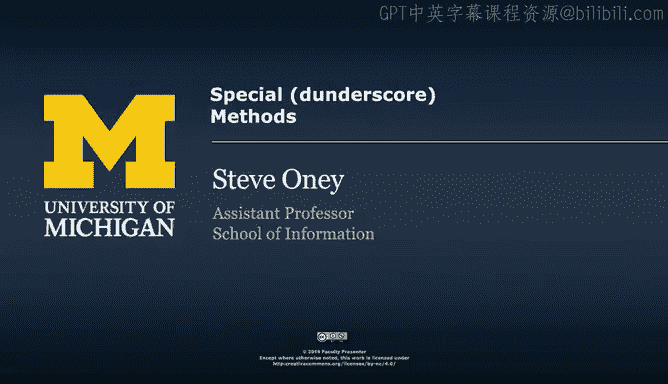
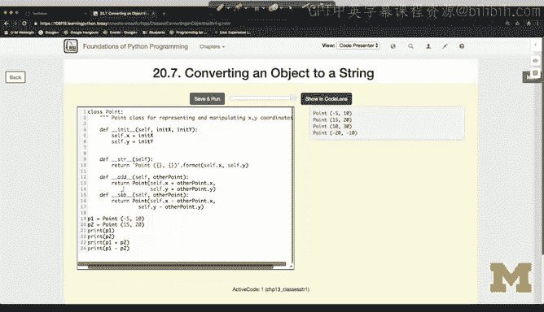

# 密歇根大学《Python3编程（课程3、4、5）》｜Python 3 Programming（Python for everyone进阶）（中英字幕） - P73：16_02_03_特殊双下划线方法.zh_en - GPT中英字幕课程资源 - BV1gj41177yd

Welcome back。 So suppose we have our point class from before。

 and we have a constructor underscore in it， D and underscore STR underscore to represent how we represent any instance as a string。

Now， suppose that we have two points as well， 01 at negative 5 and 10 and 02 at 15 and 20。

So suppose that we wanted the ability to be able to add points together。 So， for example。

 if we take point1。Plus point2。Then we might get something like point12。

And we might want to add points together by adding their x coordinates。

 So negative 5 plus 15 would give us 10， and then adding our y coordinates。

 So 10 plus 20 would give us 30。 So our new point P1，2 would be at 10 and 30。

So if we write in our code。Just to say， print out the value。Of p1 plus P2。

Then we're going to get an error saying that we can't add points。In other words。

 when we tell Python that we want to add these two point instances。

 then Python doesn't know how to actually take these instances and produce something that represents their values added together。

But we can override a method called Dundercore add Dunderco that will tell Python how to actually add two points together。

So if we say de underscore， add underscore。So add is going to take in self。

But it's also going to take in what we're expecting to add to self。 So I'll call this other point。

So for example， when we print out the value of P1 plus P2， then P1 gets passed in for self。

And P2 gets passed in for other point。Now， if we want to take the x coordinates and add them together and then take the y coordinates and add them together and return a new point。

 then what we can say。Is we want to return。A new point。

Whose x is equal to self dot x plus other point dot x。

And whose y is equal to self dot y plus other point dot y。And now。

 as soon as we define this add method， then when we print out the value of 0。1 plus 0。2。

 then we're going to see that we get a new point at 10 and 30。 Again。

 this is just 15 plus negative 5。Gives us1。And10 plus 20 gives us 30。Beyond add。

 there are several other methods that we could override。 so for example， there's subtraction。

So for example， if we wanted to be able to print out the value of P1 minus P2。

Then we could define this subtraction method。And suppose that we wanted this to be defined as。

Self dot x， minus other point dot x。And self dot y minus other pointt y。

hen now we have the ability to quote unquote subtract two points together。

There are many other methods that we can override， but they follow the same pattern as add， sub。

 and they all start and end with T scores。

That's all for now， Until next time。