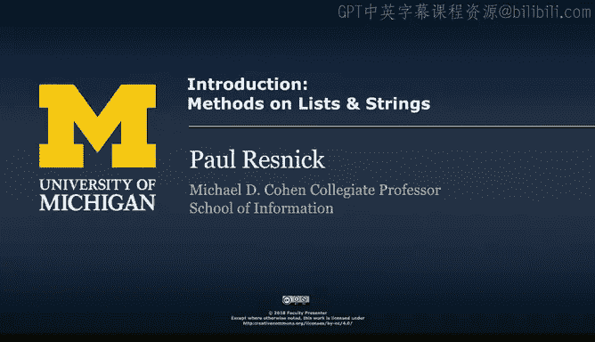
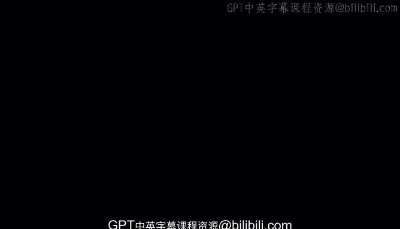

# 密歇根大学《Python3编程（课程1、2）》｜Python 3 Programming（Python for everyone进阶）（中英字幕） - P73：73_04_01_列表与字符串方法导论.zh_en - GPT中英字幕课程资源 - BV1CM411Z72u

Welcome back。This lesson， you'll learn a bunch of useful methods on lists and strings。At the end。

 you'll be able to read and write code using the following methods for lists。Apppend， insert。

 reverse， sort， remove pop。And some non destructive methods。Index and count。For strings。

 you'll learn upper， lower count， index， strip and replace。At the end of this lesson。

 you'll be able to extend a list using either a pen or concatennate。And very importantly。

 you'll be able to identify whether a method mutates an object or creates a modified copy of it。

Methods on templeples and strings can never mutate them。 Only make modified copies。

Some operations on lists mutate them。Assignment and deletion you saw previously and new methods that we'll talk about it In this lesson。

 append， insert， reverse， sort， remove and pop。 They all mutate lists。 Good luck。

 See you after the screencasts。😊。

