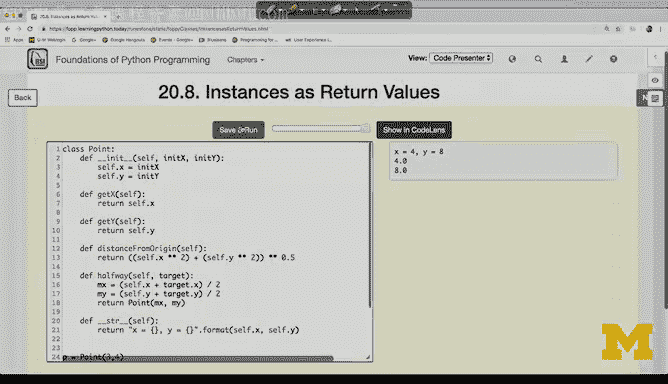

# 密歇根大学《Python3编程（课程3、4、5）》｜Python 3 Programming（Python for everyone进阶）（中英字幕） - P74：17_02_04_实例作为返回值.zh_en - GPT中英字幕课程资源 - BV1gj41177yd

。Welcome back。 So you've already learned that functions and methods can return any kind of value as their return value。

 But one thing that's worth noting is that they can specifically return other instances。

 So let's suppose that we have this point class。 and this point class has a constructor。

 and the constructor such two instance variables for x and Y。

 and we have methods get x to return the X。Instance variable。

 get y to return the Y instance variable and then distance from origin to return how far x and y are from the origin。

Now， suppose that we wanted to define a new method here。

 Suppose that we wanted the ability to accept two points and return a new point that was halfway between the two。

 So for example， here I have point P and I have point Q。

 And let's say that we wanted a function that would go return a new point that was halfway between point P and point Q。

And let's call that function halfway。 and let's make it a method on every point。 So， for example。

 if I say P dot halfway。When called with Q。Then this should。Return a new point。That is halfway。

Between P and Q。So if I call this midway， so I'll say mid。Eals P do halfway Q。

 Then I want this to return a new point。 in this case， the x should be halfway between 3 and 5。

 so the x should be 4， and the y should be halfway between 4 and 12， so the y should be 8。

So let's define that method。 So I'm going to say de halfway。Like every method it accepts self。

 And then I have a target。And we want to return a new point that's halfway between self and target。

 so I'll say the x， so the mid x is equal to the average between self dot x and target dot x。

 so self dot x plus target do x divided by 2。Mid y equals self dot y plus target dot y divided by 2。

And I can return a new point， return。point。Whose x is M X and whose y is M。And now。

 if I print out what the value of mid is。And run my code。And I'll see that I get x equals4。

 which is halfway between。3 and 5。 And I'll see that y is 8， which is halfway between 4 and 12。

 And again， note that mid is a new instance of my point class so I can do things like。Print out。

Mid doc get x。And I can print out mid that get y。And I'll get  four and8 respectively。

 for those values。That's all for now， until next time。

