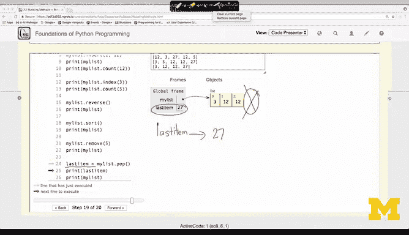

# 密歇根大学《Python3编程（课程1、2）》｜Python 3 Programming（Python for everyone进阶）（中英字幕） - P74：74_04_02_列表方法详解.zh_en - GPT中英字幕课程资源 - BV1CM411Z72u

Let's see some useful methods that operate on lists。 Some of these methods will mutate the list。

 Some of them will just return a value。we've got a lot of things in this code。

 let's run it using code lens so that we can step through it one and step at a time。

Our first command。Just creates an empty list。The next thing。Calls the append method on it。

 That's line 2。So just as with Alex dot forward， we have my list dot append。That means。

Run the append method。On my list。Which says， add a new item to the end。In this case。

 the item will be whatever we've passed in as an argument。 It' going to be the value 5。

So we start with an empty list。After we run this， we'll have a list containing one element。

 the value 5。If I do it again。On 9，3。Now， the value 27 is going to be appended to the end of the list。

So we'll have 5 and 27。 I can do it a third time。 this time3 will be appended to the end of the list。

It's helpful to notice here that the variable， my list。Is always bound to that list object。

So we have the arrow pointing to it。 That never changes throughout all of this。

 What changes is the list itself。It's getting additional elements added to it。

So we get a fourth element there， if I now print it out。It'll show up in the output window。

A second useful method is insert。 A pen always sticks an item at the end。 insertt。

 inserts the item wherever you tell it to。In this case。

 we're going to tell it to insert at position number one。So it's going to go to position number one。

 and it's going to insert it。 It will not。Erase the current contents at position number one。

 That's what we had with assignment。Recall， we could do something like my list。Square bracket。1an。

Equals a new value。That would replace the 27 with 12。

But that's not what happens with our insert command。Our insert command。Slicees our new value in。

Right before position1。It will go forward。And sure enough。

 the 12 has been inserted there between the 5 and the 27。Can print that out。

 And now the list has five items in it。Line 10 introduces a new method， called count。

The argument that you passed account in this case，12 is not a position in the list。 It's a value。

The count operation is going to go through all of the values in the list。

And count how many of them are equal to 12。So， in this case。The count will be2。

What' something you did with an accumulation pattern in a previous lesson。

But the count method just does it for you。 counts how many times 12 appears in my list。Index。

Is a method。Where we will。We will pass in。A value。And it will tell us the position。

Where that value can be found。So， we'll pass in。The value 3。And it'll tell us the index。

 the position。Where that three can be found， perhaps somewhat confusingly， it's also three here。Zou。

We're gonna。Get back the value 3。Print my list dot count of five is going to look through and find all the places where5。

Appears there's only one of them。 So we'll get account。Of one。My list at reverse。

Takes the order of the items in the list。And changes them。So the last。Becomes first。

And then we get the three。The 27。The 12 and the5。But these values。

Are actually going to go back into the original positions。 So the list itself is being changed。

 We're not making a new copy of the list。So when I run that。It actually reverses the items。

I print it。 They come out in the opposite order that they were in before。So it is another method。

 It's going to take the items in the list and just reorder them from smallest to biggest。So。

 we'll get。3。Men，5。And 12， and another 12， and。27。So sort and reverse， keep all of the same items。

 but they rearrange them。Into a different order。Our next。Method。We see on line 21 is dot remove。

You've seen previously a deletion operation。D E。 L。Wch。😔，Takes a。Position。😊。

And whatever item is a position one would get deleted if I write D EL of my list square bracket1。

That remove doesn't specify。A position， It specifies a value。So it's going to remove。The5。

 wherever it is。Then now the five is gone。There's one more operation for removing items， pop。

It removes the last item from the list。So， in this case。When we pop my list， well get。27。

 And it actually returns that value。So the list will be changed and we'll get the value 27 back。

In this case， we've chosen to assign the results of the pop operation to a new variable called last item。

And sure enough。Last item。Now has the value 27。So to summarize。

 you've learned here how to use several mutating operations， mutating methods on list， append， index。

 reverse， sort， remove， and pop。We've also seen a couple of nonmating。Methods。

 index and count that return values。And pop。That was a mutating method that changed the list and also returned to value。

Of all of these， I would say append is the method that's the most important。

 You'll be using aend all of the time。

See you next time。