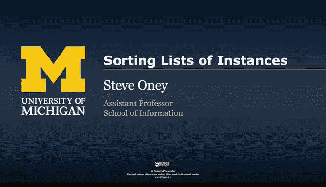
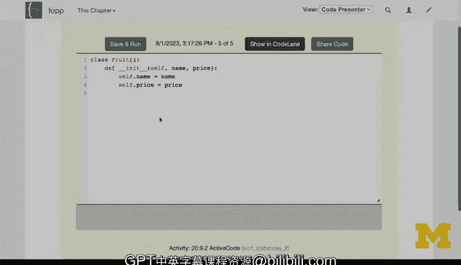
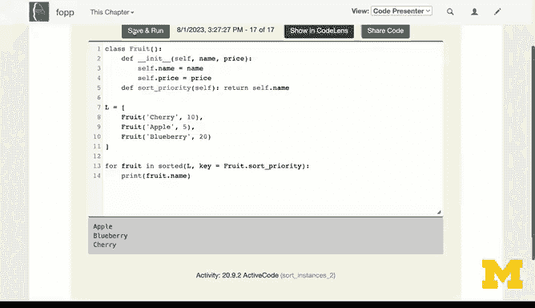

# 密歇根大学《Python3编程（课程3、4、5）》｜Python 3 Programming（Python for everyone进阶）（中英字幕） - P75：18_02_05_实例列表排序.zh_en - GPT中英字幕课程资源 - BV1gj41177yd

Welcome back。It's often useful to be able to sort instances of classes according to some criteria。

 so let's suppose that we have a class fruit to represent a fruit and every fruit has a name and a price。

So if we have a list of instances of fruit， so let's suppose I have three instances， so I'll say。

Cherry。그。Apple。And。Blueberry。And if I want to be able to sort these list this list of instances。

 which I just put into this variable L， I might be tempted to say。Print sorted。When called on L。

If I try to do this， then here I get an error and what this is saying is lesson than is not supported between instances of fruit and fruit on line 12。

 so essentially what this error message is saying is that Python has no way of knowing which fruit instance should come before or after which other fruit instance when we' sorting them。

 so should this apple instance come before a cherry instance or should that be before a blueberry instance。

 there's no kind of sorting criteria for determining which one should come first。

So there are two ways of solving this problem。One is to do what we've done before。

 and that's to specify a key function to sort by。So I'm going to do this by creating another method that I call sort priority。

그。And what the sort priority method is going to return？Is whatever I want to sort by。

 so in this case， let's suppose that I want to sort by price， so I'm just going to say return self。

 price。嗯。So here sort priority is not a special method name。

 it's just a method that I named and defined， and now I need to say that I want to sort by this sort by priority by passing in an argument to sorted for the key。

 so I'll say key。Equals fruit。Thatt sort。Priority。对。So now when I do this。I'll see that it works。

 And in this case， I'm just getting fruit objects。 so I'm going to。Rewrite this a little bit。

 so I'm going to loop over。All of the fruit instances， and I'm just going to print out。That fruit。

Name。Okay， so now if I sort by price， I can see that I get Apple first。Then Cheerry。

And then blueberry。Which seems correct？If I wanted to instead sort by name。

Then I could replace price with self dot name in my sortRT priority function。And if I do this。

 then you'll see that it gets sorted alphabetically， from apple to blueberry to cherry。Now。

 I could write this in a slightly different way and get something equivalent as well。

 so I could say key equals lambda F and f is going to be a fruit instance。And I could say call F。

That sort priority。And this is going to give me the exact same。Result。

Or I could also get rid of this sort priority method。

And just put the property that I want to sort by directly in my Lambda function。

And this is going to work as well。But all of those techniques are one way of sorting lists of instances。

 which is by passing in an argument to sorted， which specifies what we actually want to sort by。

 which is key， and this is just the same principle that we used when we've sorted dictionaries or lists or any other object as well。

So that's one way of sorting a list of instances。Another way。

If you recall when I ran my code originally。I got this error saying lesss than is not supported between instances of fruit。

So another thing that I could do is I could actually define what it means for one fruit to be less than another fruit。

Now the way that I do that is I define a method that is special。

 so here I'm going to say de underscoreco LT。LTE being short for less than。

And you'll see that I have these two underscores or underscore。

 and that should tell you that this is a special method。So when we define a method named LT。

 what this is telling Python is that this method is what it should call when it needs to compare two instances。

So it's going to accept two arguments， one for self as always。

 but then another for the other instance。So in this case， other instance is a fruit instance。

So what our less than function should return is true if this instance or self should be considered less than the other instance。

So in this case， let's suppose that I want to sort by price by default， I'm going to say that self。

Is less than other instances if my price is lower， So I'm going to say return。Self dot price。

Is less than other instance that price。So now if I do this。

The first thing you'll notice is that if I run my code， then it actually works。

 right So if I call sorted L， then now I get Apple， which is。Lowest in price， then cherry。

And then blueberry。I can change my sort order to any other instance variable as well。

 so I could actually say return self dot name is less than other instance do name。 Now。

 this is going to seem a little bit weird because name is a string。 but in Python。

 if I do a less than comparison between strings， then it's going to return kind of their alphabetical order。

 So in this case， the letter A is going to be less than the letter B in the letter B is going to be less than letter C。

 And so as a result， if I call this。 then now I'm sorting it alphabetically， Apple。

 blueberry and cherry alphabetically。Another consequence of overriding this less than method is it also allows me to actually compare two instances of fruit if I wanted to directly。

 So let's suppose that I have。Cherry equals fruit cherry。And I have Apple。Equals the fruit apple。

What I can actually do now is I can print is Apple less than cherry？And when I do this。

 what Python is automatically going to do is it's going to。Convert this into Apple。Dot。Less than。

Cherry。And so in this case， because if I switch this back to price。So in this case。

 my apple's price of five is less than the cherries's price or other instances price of 10。

 and so when I print this out on line 18，Then I should get true。

So those are two ways of sorting a list of instances。

 one by overriding the less than method and specifying how we should always compare to instances。

In another， by instead specifying the key property。

So we could do that by having a Lambda function just like before。

 or maybe a better way would be to define a method on our class that we then call。Like this。嗯。出。

So that's all for now until next time。

