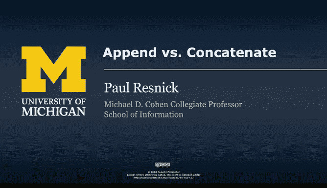
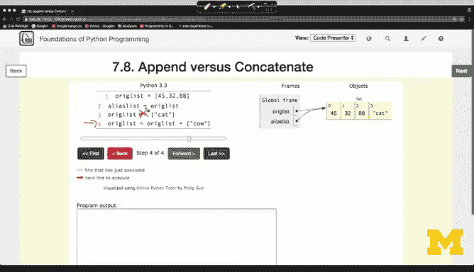

# 密歇根大学《Python3编程（课程1、2）》｜Python 3 Programming（Python for everyone进阶）（中英字幕） - P75：75_04_03_追加与连接对比.zh_en - GPT中英字幕课程资源 - BV1CM411Z72u

Welcome back。There are two ways to add stuff to the end of a list。1， we've seen already。

 and illustrated here。Is to append。So， orange list。

On line  one gets assigned to a list of three things。 And then on line 3。

 that list gets an additional item at the end。 It gets cat added to the end。The second way。

Is using concatenation， the plus operator。So on line 1， we create the same list。But on line three。

 we're now going to use concatenation。And then， reassignment。So we concatenate the original list。

With a new list， the new list has only one item in it。

And then we reassign that back to the same variable。

 So orange list is going to end up being bound to。To a new list that has four items。45。32。88。And。

The word cat。Now in code lens， it's not actually going to show us。That we have a new list here。

Because there's nothing pointing any more to the old list。

 And so it doesn't bother to show it to us any。 So it'll look like we've just replaced the old list。

 but it's actually a new list with four items。😔，So sure enough， that's what we get。

 Now let's look at a little more complicated one。Here on line  one， again。

 we're creating orange list with the three values in it。

 And then we're just printing out some things to remind us of what those are。 But then on line 4。

 we're doing something different instead of。Reassigning the concatenated list of orangeless plus cat。

Back to O list， we're reassigning it。To a different variable called New list。

So let's see how this is going play out in code lens。On line one， we assigned the list to O L。

And we're just printing out some stuff。Line 4， we' making a new variable and its pointing to the new list。

 So remember before it didn't show us that the old was still unchanged Here。

 we're seeing that the old list with， with just three items in it is still bound to the variable orange list。

Even though we did a concatenation operator。That did not change the contents of the actual list。

 It made a new list。And then we bound that to a new variable。So then we print some stuff out。

And now we actually are using an append operation。That's going to stick a new value an additional value onto orange list。

And so we're going to get something added on here to O list。We're gonna to get。Cat here， as well。

that's what we'll get。Let's run it and see。Sure enough， Ka is added on to that original list。

 as well。And then we print some more things。Now we've printed out the identifiers。

Like these long numbers， just so you can see that orange list。

Is pointing to one object with one identifier， a new list。

Is pointing to a different object with a different identifier。There's one more tricky thing。

To know about a pendant concatenate。 And that is that this plus equal sign that we've seen previously。

We've seen it as we had things like X。Plus， equals。1。And we described that as being a synonym。

Just another way of saying x equals x plus 1。In the world of mutable lists。

 that's not quite true anymore。They're not quite the same。Now。

 what's going to happen with the plus equal sign。When we do it with a list。

 is that it actually is going to mutate the list。 It doesn't make a new list。And concatenate to that。

 The only time that's going to matter is if we have some other alias for the same list。

 So in this code。Let's run it。The first line of code just assigns a list of three items to O list。

 The second line of code。Makes a new variable that points to that same object。

 So alias list is an alias for or list。And now we're on to line 3。On line 3。

 we have this orange list plus equals cat。And we're going to see that that's a slightly different thing than saying。

Orange list。Equals or list。Plus， the new thing。The difference is that we're actually going to extend。

The original object。And because we extend the original object rather than making a copy in a new one。

 we will also affect any aliases for it。So when we run this。We will find。

That not only does O list now have cat as its last item， but so does alias list。

So this is a different outcome than we would have gotten。

Had we run this line of code instead of line 3。My suggestion is。With lists。

 don't use the plus Equ operator， it's just too confusing。Sick with what we have on line for。

 where we say orange list equals orange list plus another list。Don't use。

The plus equal operator with lists。On the textbook page about a pen versus concatenate。

 as with many of the other pages， there are lots of useful exercises。

 and I encourage you to try those out。

We will see you next time。Cut。