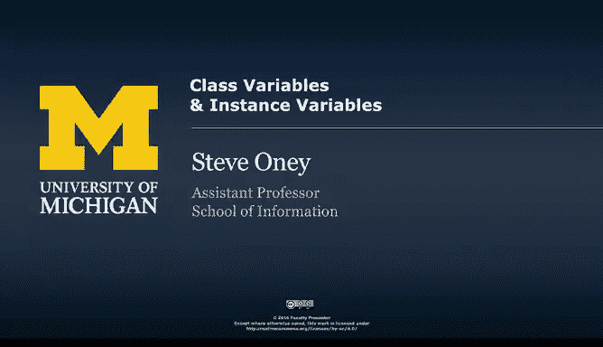
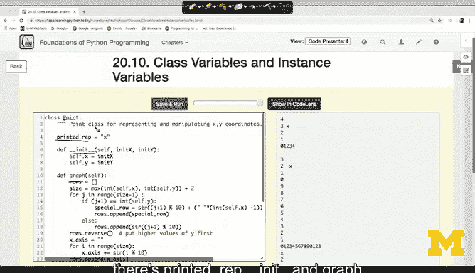

# 密歇根大学《Python3编程（课程3、4、5）》｜Python 3 Programming（Python for everyone进阶）（中英字幕） - P76：19_02_06_类变量与实例变量.zh_en - GPT中英字幕课程资源 - BV1gj41177yd

Welcome back。 So we've already seen that every instance of a class can have its own instance variables。

 So， for example， here， we have a point class and inside of the constructor to underscoring it。

 we can see that every point instance has instance variables for X and y to represent the position of that particular point。

Now， for example， here， when we create a new instance of point with x equal2， y equal 3。

 then suppose that our point class is represented with this notation again。

So this represents our point class。And P1 is an instance。Of the point class。

That has instance variable x set to 2。And instance variable， y。Set to 3。

Now we also have another instance of our point class。So that's P2。And P2 has x set to3。

And why set to 12。So we have P1。And we have P2。So one thing that I want to know is that instances have their own variables。

 but classes can have their own class variables， they work just like instance variables。

 except that they belong to the class itself。So for example， here。

 the point class has its own class variable called printed rep。

 so I'm going to write that inside of the class point， so I'll say printed rep。Is set to a star。Now。

 the point class also has these methods， which are also a form of class variables。

 so we have underscore it。And its value is some function。

And we have this graph method whose value is a different function。Now。

 whenever Python searches for anything of the form。Instance name。Dot instance bar。So， for example。

 if we're doing P1 dot graph or P2 dot graph or even something like。Print p1 dot printed。Rp。

Or print p1 dot x。Then the search order that the Python evaluator goes in is it first searches inside of the instance。

 So in this case， if we're searching for p1 do x， then it searches inside of P1 and it finds x there and it evaluates that to B2。

 if it doesn't find an instance variable with the name X， or in this case。

 let's go with the example of P1 do printed rep。 So if we're searching for p1 do printed rep。

 Python first searches inside of the instance P1。It doesn't find it there。

 so then it searches inside of the point class， and that's where it finds it。When we say p2。 graph。

 Python first searches inside of P2， it doesn't find it there。

 and so it searches inside of the point class where it finds it。

If we had something like print P1 doty。Then Python would first search inside of P1， there。

 it then search inside of the point class， it wouldn't find Pz there either。

 and so it would give us a runtime error。Now the way that we define this point class。

I erase these annotations。The way that we define the point class is that we have this graph method。

 and what graph does is it kind of。Forms a text graph or a textual representation of a graph that contains this point。

So。If I erase my annotations and I run my code， so here I create two instances of point1 at 23。

1 at 312， and I call P1。 graph and what that does。Is it creates a little textual representation where here you can see kind of an X axis。

 here you can see kind of a Y axis， and I can see that my point。Pwan。Is that two。So 2 and3。

 And I can see that my point P2 is at 3。And12。Inside of this representation of graph。

 I refer to self dot printed rep。So you'll note that here printed rep again is the class variable。

That's set to a star。If I change printed rep to B， let's say， a lowercase X。

Then you'll see that printed rep changes for both P1 and P2 when we actually call the graph method on both of them。

So that's an example of how classes can contain variables。 So again。

 we have instance variables that belong to every particular instance。

 and we have class variables which belong to a class here。 technically。

 there are three class variables。 There is printed rep to underscore in it。

And graph that all belong to the point class。 That's all for now， until next time。

