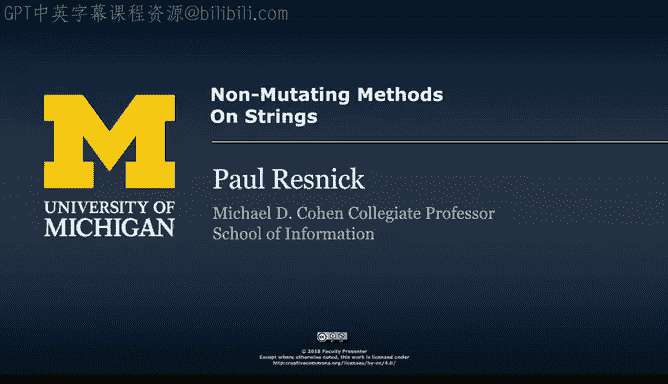
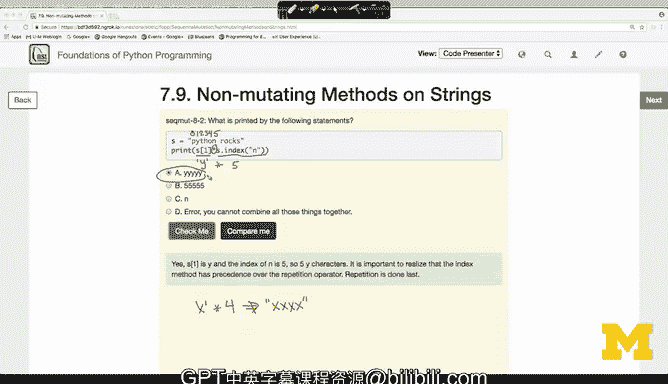

# 密歇根大学《Python3编程（课程1、2）》｜Python 3 Programming（Python for everyone进阶）（中英字幕） - P76：76_04_04_字符串非变异方法.zh_en - GPT中英字幕课程资源 - BV1CM411Z72u

Welcome back。Let's see some useful methods on strings。

Remember that none of these methods can ever change or mutate the original string。

 They can only produce a new one based on the old one。First。

Let's learn about the upper and lower methods。I'll show this in code lens。We create a string SS。

Is bound to， hellello， Im a world。If I。Called the upper method on it。

 All of the letters become capital letters。So we get hello world and capitals in the output。

 but notice that S S hasn't changed。 It still has the small letters。I can also call the lower。Method。

 which will make the capital H and the capital W B small letters。In this case。

 Im assigning it to a new variable called T T。That's what the T T equals a line4 does。

I can print that out。And again， S has not changed。 It still has its original value。Nextt。

 i'll show you count strip and replace。In this example。Hello world。As a bunch of。

Spaces at the beginning and some more at the end。The count method works similarly to the way count works on lists。

You specify as an argument。What value to look for。In this case， a letter。

And we're going to look for L。 it appears three times。So the count method returns the value3。

 and we're assigning it on line 3 to the variable ELS。So now ELS has the value 3。

 you can print that out。Line 6 is a little bit more complicated。Here， we've got。

Something that's going to get printed out， nothing's going to change with our variables。

But the thing that's getting printed out requires a little sleuthing to understand。

 So we've got the plus operator。Twice。And so we're going to have three different strings。1n。😔。

2 and a third here。And we're going to put them all together。 So we're going to get star， star， star。

And we're going to have star， star， star at the end。

What we get in the middle is whatever is returned by calling the strip method on S S。

What the strip method does。As it looks at a string。

And it looks for any white space at the beginning and white space at the end。 And it gets rid of it。

Leaving only the characters that are in the middle。White space in the middle。 That's okay。

 That does not get removed。So， we get。Hello。So that's our new string。

And we're not assigning it to any variable， but we're just asking for it to be put into the output window。

So we get hellello worlded with the stars instead of the spaces in our output window。On line 8。

We are calling the replace method。So that's gonna to look for any place where。

The letter O appears in its gonna。Put in star， star， star， instead。然。😔。

Stringings can never be mutated。 So what's going to happen is we're going to get a new string。

That has those replacements in it。And that's going to be bound to our variable news。So。

 here we can see that the。O was replaced by three stars。 This O was also replaced by three stars。

But still， this string。That S S was bound to。 It is unchanged。And we can print that out。

News has these。White space at the beginning。 So that shows up in the output window。As with。

Other pages in this text， there are。More useful exercises。Andm not going to go through them all。

And I do wantna do one here that I think is particularly。Illuminating。

So here S is bound to a string Python rocks。And we're going to print out this complicated expression。

So you have to get used to kind of breaking these big expressions into parts。And this star operator。

If I said。Quote x。Times 4。That would give me a string。X， X， X。X。SoIt just repeats the string。

 however many times you say when you're multiplying。

So we really need to have the thing to the left of the star。Resolve to some character string。

the thing to the right of the star， to resolve to a number。And that's what they're going to do。

S square bracket1。Well， we have position zero， position one。So， S square bracket1。Is why。

An S dot index of n that says what position。Can you find the letter N。In the string， S， well，0，1，2，3。

4。5。So it's the letter Y。Times 5。And when we print it out， we get it without the quotes around it。

 so。Sure enough。It's the letter A。There answer A， which is why， why， why， why。

So to summarize what we've learned。In this segment， all methods on strings are non mutating。

 They leave the original string alone。They generate new strings。

So if you want to keep changing a string that's bound to a variable。

 you'll have to make a new version of the string and reassign it to that same variable name。

So the methods you've seen here are dot upper and dot lower to make the string all uppercase or all lower case letters。

That count defined how many occurrences of some substr occur in the larger string。That index。

 to find the first position in the string。Where the substr can be found。

That strip gets rid of all the white space at the beginning and the end of the string。

 and that replace replaces all occurrences of some substr with a different substr。

We'll see you next time。

