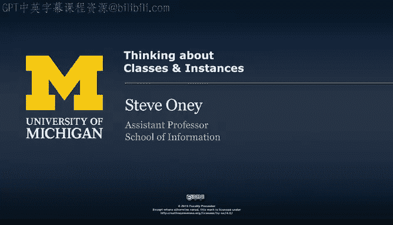

# 密歇根大学《Python3编程（课程3、4、5）》｜Python 3 Programming（Python for everyone进阶）（中英字幕） - P77：20_02_07_类与实例的思考.zh_en - GPT中英字幕课程资源 - BV1gj41177yd

Welcome back。Before you write any code for classes。

 there are a few questions that you should ask yourself。

 First is what kind of data do you actually want to represent with your class， Is it a list of songs。

 Is it a list of students， a list of cars， et cetera。 And then once you know that。

 then you should ask yourself， what does one particular instance represent of this class。

 So if it's a list of songs， one particular instance might represent a song。

 One particular instance of a list of students might represent one particular student。

Then from there you should ask yourself what are the instance variables。

 what's unique to every instance that I might have so if it's solicit a student。

 it might be something like a name， a student ID， if it's solicitor songs， it might be the artist。

 the track name， the length， etc。And then after you know that。

 you should also ask what methods might you actually want。 So if every instance is a particular song。

 then you might have a method， for example， to ping an external API to get the lyrics for that song。

 If it's a student， you might want to have a method to， for example， send a message to that student。

 It depends again， on what your instances represent。Then finally。

 you should ask yourself what does a printed representation of an instance look like。

 So if I print out a particular song， then I might want to print out the track name and then the album name and maybe the length。

And you should have answers to all of these questions before you start writing code for classes。 Now。

 it's important to note that designing class is really more of an art than a science。

 And it's very common to also refactor or rewrite classes in instance variables and methods。

 even for experts。 But all of this comes more with practice。 That's all for now， until next time。

