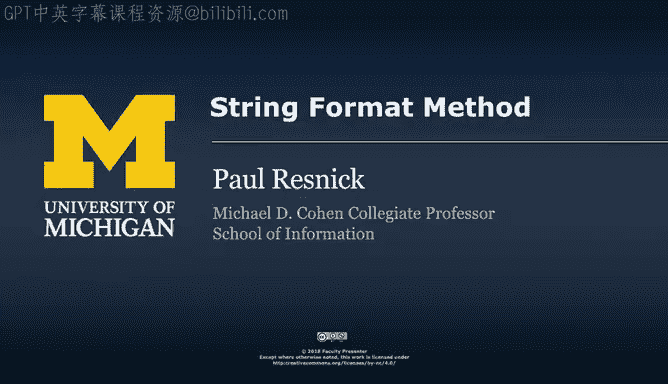
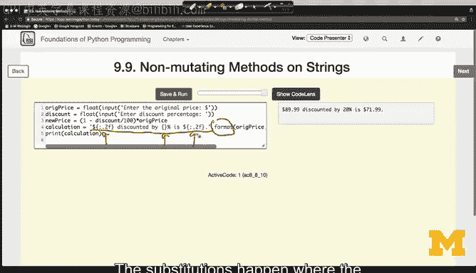

# 密歇根大学《Python3编程（课程1、2）》｜Python 3 Programming（Python for everyone进阶）（中英字幕） - P77：77_04_05_字符串格式化方法.zh_en - GPT中英字幕课程资源 - BV1CM411Z72u

Welcome back。There's one more method for strings that's a little more complicated and important enough to warrant its own video segment。

We can concatenate a string together， including some hard coated parts。

And some variable parts like this one。We've got。A hard coated part， Ho。Period， your score is。

Then then we've got some variable parts， like。Name。And the score。If I run it， where you can catnate。

 we get hello。We get。Rodney Dangerfield。That's coming from name。Your score is。

Mus1 is coming from there。So one thing to notice about this is it's just sort of a little hard to read。

It's a little hard to read this and figure out exactly what it's going to look like over here。

And you got to be careful about things like getting the period， which really belongs with。

The end of the name。 But you got to stick it on there。 You got to remember to put spaces there。

 You have to remember that score is a number， So we got to pass it through the SR function in order to turn it into a string。

 There's a lot of stuff that's not so convenient here and not so readable。

 So we're going to have a new command。 the dot format method。

 that's going make this a little cleaner。Before we get to that， though。

Let's just do a slightly more complicated version of this。

Where instead of saying just rodney danger field score that we're going to get。A whole list。

Of tuples。We've got Rodney Danger field with a score of -1， Marlon Brando getting one。 and。

 of course， you would get 100。And we're going to loop through all these people。For each of them。

 we're going to print out something like that。Like what we did for Rodney Dangerfield。 So hello。

 Ronnie Dangerfield， Ho， Marlon Brando， and hello you。

What I'm going to do next is show you something that's going to replace。

That concatenation with something that's a little cleaner。So I've just replaced line 5。With。

Something that is little cleaner。 We have a first part of it， which is called the format string。

And it's got some things in it， which are places where we're going to do substitutions。

So we have a complete formatstering。 and you can kind of look at that and get a sense of what the shape is of the thing that's going to come out at the end。

 But we're going to have some substitutions。 And this first set of curly braces says。

 do a substitution here。 And we have positional replacement。 So the first。Value。

Is going to get stuck in there。And the second value is going to get stuck in here。So looking at this。

 we have。A format string。And then we are calling a method on it。The dot format method。

So it's a method on that string， and we're passing in a couple of parameter values。

The first parameter value is going to get substituted in for the first curly braces。

 the second parameter value for the second curly braces。So when I run this。

The first time we get to line 5 name will be Rodney Dangerfield， and score will be -1。

 That's what's going to get substituted into the hellello string。

And the next time it'll be Marlon Brando and so on。So we get the same result as before。

But our code is a little more readable。 We'll be doing this more and more as the specialization goes on。

 using these format strings， rather than concatenating together strings out of individual parts。

So a little vocabulary that we have here， we have the format string。We have parameters。

And these are the parameter values that are getting passed in。

 and then we have references post to substitute in those parameters。

Here's another example that's a little more complicated。

 where we can give some hints to the format method。

 telling it how many decimal places to use for numbers。In this program。We're first asking the user。

To type in an original price for an item。And then， a percentage。It's going to be discounted。

We compute a new price from the original price in the discount。 and then we're going to just。

Create a string。And finally， print it out。The string that we're going to create is we're going to have。

A whole sentence。That includes some information about the original price。

How much the discount was and what the new price is。

 And those things are going to get substituted in。 The original price will go here。

The discount will go here and the new price will go here。

The new thing that we're seeing here is this colon。Po2 F。

And what that says is the thing that's going to get substituted in here。Is a floating point number。

That's what the F is saying， and the period 2 is saying after the decimal point。Have two more digits。

So if I run this and see what it looks like。I'm going to have an original price of 89，99。

We're going to get a 20% discount。And that comes out saying that 8999 discounted by 20% is 7199。Now。

 it isn't。The case that 20 per cent off of 89，99 is exactly 71，99。

It's actually a tiny bit less than that， but the closest number that's in dollars and cents is $71。

99。If I told the Python interpreter that I wanted four decimal points instead of two。

Then it would print it out with more precision。Let's take our 8999 item。Get a 20% discount。And now。

 it turns out。It's 71 99，20。So we can control。How many numbers we get after the decimal place。

By specifying it in that inside the curly braces。If we remove the hint entirely about how many decimal places to use。

Then it just goes and uses its default。In this case， it's giving us three decimal places。

 If we had some different value， we might choose to give us more decimal places or less because we weren't giving it any instructions on how many did do it was。

You， using its built in algorithm to decide it。If we want to control exactly how it comes out。

 that's when we use this little hint。And for dollars and cents。

 it really makes sense to have two decimal places。Because that's the precision for dollars and cents。

All right， so that's the format statement， just a reminder a format statement。Begins with a。

 with a format string。And then we call the dot format method on it。

And we pass in any values that are supposed to get substituted。

 the substitutions happen where the curly braces are。

We'll see you next time。