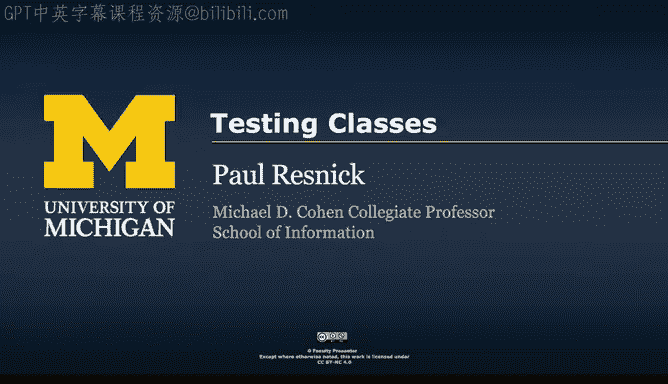
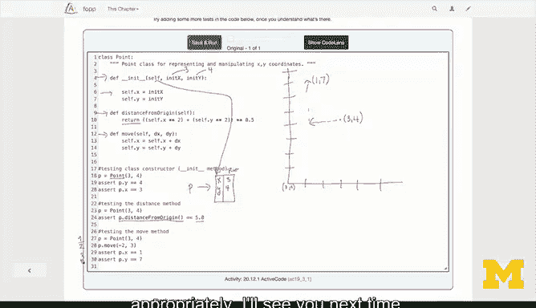

# 密歇根大学《Python3编程（课程3、4、5）》｜Python 3 Programming（Python for everyone进阶）（中英字幕） - P78：21_02_08_类测试.zh_en - GPT中英字幕课程资源 - BV1gj41177yd

Welcome back。Testing a class definition involves creating instances。

 andvoking methods on those instances， and then checking the results。

Here's the little class that lets us to find points on an XY plane。

Instead of just treating them as two numbers or making a tuple。

 we're going to actually make an instance of a class。

 each instance will represent one point with an attribute for its exposition and another attribute for its y position。

I'm going to draw a little grid just so we have a place to plot our points。

So if I have a point like 3，4， x goes 1，2，3， y goes1，2，3，4。So right about there is the point。thre。f。

To test our definition of this class， we're going to have to test the three methods that we have。

We have。Constructor， the thunderco in it。We've got the distance from origin method。

And the move method。Distance from origin just says， how far is the point from？0，0。

And move actually will move the point to somewhere else。

So let's start by testing the constructor because that's really the heart of any class。

How do we test if we've implemented the constructor correctly？To figure that out。

 you have to remember the mechanics of classes。We create a new point by。Invoking。The class。And that。

That creates。A new blank instance。Of the point class。We passed that。Blank instance。

Into the constructor。So， self。Gets bound to that point。

In it x gets bound to the first value we passed in， which is3， in it Y gets the second one。

 which is4， and then we execute the code。Inside the constructor。So self， that's this point object。

This instance。Is going to get its X attribute set to be。Whatever in it x is， which is 3。

And why is going to get set to be。4our。We then returned that whole point from the Invocation and so P。

Is the global variable P is going to get bound to that point。So to test the class constructor。

 we create a point and then we check。Whether its attributes are correctly set is its y value 4。

 is its x attribute set to 3， so line 18 of the code creates a point instance。

 lines 19 and 20 check whether its attributes have been set correctly。

Usually when we're doing a side effect test， we would have to create an object like a list or a dictionary。

And then invoke a function。And then see if the list or the dictionary has appropriately changed。

In this case， we didn't have to do that because the invocation of the point class on line 18 both creates the instance and invokes the method。

So those two are combined into one step， but then afterwards。

 we do run our tests to see whether the point is correctly set up。By the way。

 if this is a little confusing for you because you're just coming from learning classes and the mechanics are a little hazy。

Running this in code lens on your own would be really helpful to make sure you understand what's going on。

Now the next method that we're going to test is the distance from origin method。

This method is supposed to tell us how far away the point is from the origin。

 in this case it's a distance of five。This method returns a value。So we can do a return value test。

I still need to create a point in the first place and I could have just used the point P that I defined on line 18。

 but when I'm defining a test， I like to have everything that's involved in the test right there。

 so I'm recreating a new point。Online 23， and it's again at position 34。

Then I'm checking that it's a distance of five away from the origin。We assert。

That the value returned by the distance from origin method。Is5。

I should really be checking for some other points， I should check whether the 。

20 is at a distance of two away from the origin and things like that。But this gives you the idea。

Now finally， I've got this move method。What's doing is taking a point like the 34 point。

 and it's going to translate it， it's going to move it to a different position。

So we're going to say how far。In this case， we're going to try to move it。Two to the left。

And three up。And we should end up at one。seven。This is a method whose purpose is to have a side effect。

 it's supposed to change the point， so we need to have a side effect test。That involves three steps。

First。Online 27。I create my initial point。Second。928。I move it。And then third aligns 29 and 30。

I check whether it's in the right location at the end。Is it x attribute 1， is its y attribute 7？

So that's the skeleton of how to test a class definition。

 basically you need to assess for each method whether its purpose is to return a value or have a side effect。

Testing the class constructor is special， each test will invoke the class with some parameters。

And then you'll check whether the returned instance has its instance variable set correctly。

For the other methods， you'll also have to create an instance。

 but then you invoke the method on the instance and either check whether the return value is correct。

 or you check whether the instance has had its instance variables changed appropriately。

I'll see you next time。