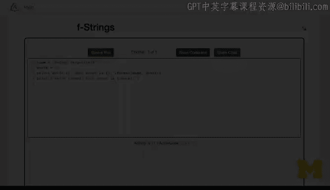
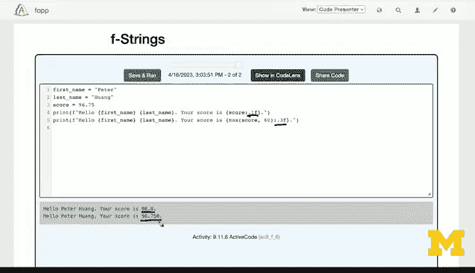

# 密歇根大学《Python3编程（课程1、2）》｜Python 3 Programming（Python for everyone进阶）（中英字幕） - P78：78_04_06_f字符串格式化.zh_en - GPT中英字幕课程资源 - BV1CM411Z72u

Starting with Python version 3。6， there's an even easier way to create complicated strings called F strings。

With dot format， which we saw in the previous video。

 you have curly braces to indicate a substitution。Like those curly braces or these。

But then the expression that produces the new value。

 the thing that's going to get substituted for those curly braces comes later as a parameter。

To the dot format method and， so we get name and score over here。And you kind of have to work to。

Realize that。Name。Goes with that one and score with that one。With F strings。

 you can put a Python expression right inside the string。You can see that on line four。

Here we have something a little similar with the curly braces。Out right inside the curly braces。

We put the variable name。And score goes inside that curly braces。 The lines 3 and 4。

 they do exactly the same thing。 if I run this。You'll see that they both produce the same exactly the same output。

Now， the way to tell the Python interpreter that you want an F string with substitutions instead of just a regular string is。

 well， the letter F before the string。So this F says， hey。

 this is going to be an F string where we might have substitutions。Inside the curly braces。

Where I've put a variable name， you can actually put any Python expression。

 so let's look at some examples。Here。Inside the curly braces， I've put a string。

Rather than a variable name。And I put a。A number and this still works， no problem。

Here I have inside the curly braces， a more complicated expression， The concatenation of two strings。

 So we've got Peter plus。😊，Wong， again。No problem。It can take an expression there。Now。

 I don't recommend that you put complicated expressions inside the curly braces。

The idea of F strings is to make your code readable。And this is not really so readable anymore。

 I'd prefer something like maybe just a single string here。That's more readable。

Or since this is just a string literal。I don't need the curly braces at all。Or even better yet。This。

 with variable names。Inside the curly braces so that we're not hard coat a particular person's name。

So， I do。Each of them。As its own。Curly Braith。First name and then last name。

Our expression inside the curly braces can include function calls or method calls。 For example， here。

 by calling the function min。We either get。The score。Or the number 60， whichever is smaller。

Note that min is a function that's built in with Python。As a matter of style。

It's okay to include function and method calls， but be careful not to make your expressions too complicated。

You want a person to be able to read the code and easily imagine what the output should look like。

You can use the same format specifiers with Fstrs that you can with dot format。Here， dot 0。1 f。

Means round to one decimal place。 So score colon that 1 f round to one decimal place。

 which is going to lead to the output。96。8。不。So， one decimal place。8。Or。

We could say we want three decimal places。And then we get。96。750。

You may encounter code that uses either dot format。Or F strings。

 It's worth learning how to read both of them。For any new code you generate。

 I would recommend using F strings。

See you next time。