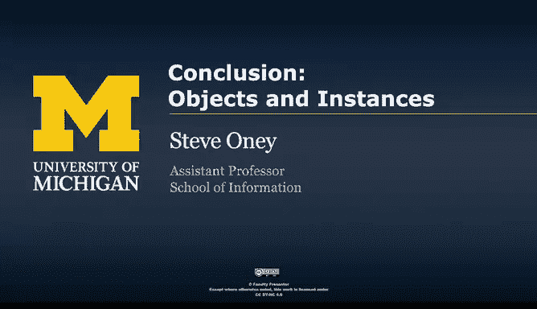
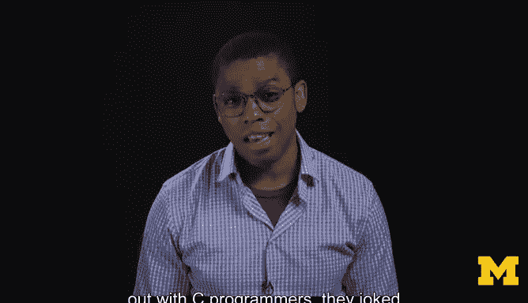

# 密歇根大学《Python3编程（课程3、4、5）》｜Python 3 Programming（Python for everyone进阶）（中英字幕） - P79：22_02_09_小结：对象与实例.zh_en - GPT中英字幕课程资源 - BV1gj41177yd

So in this lesson we learned more about how to work with class instances。

 but one thing that I want to note is that almost everything in Python is an object with properties and methods。

 so really we've been working with instances throughout the specialization。

 whether it be turtle instances， strings， lists， etc。

 the only thing that's really changed is that now we're working with instances of classes that we're defining rather than the built-in classes。

 but you can do the same things with them like sorting， adding， etc。

So one of the great things about object oriented languages like Python is that we can define classes in a way that allows us to operate on instances intuitively。

 like defining a point class and defining the Dco add method so that we can just add two points using plus。

One of my friends is a Python programmer， and they joked that they refuse to even hang out with people who program in non objectject oriented languages like C。

 I personally feel that's a bit harsh， but when I asked them why they wouldn't hang out with C programmers。

 they joked that it's because they have no class。

See you next time。

