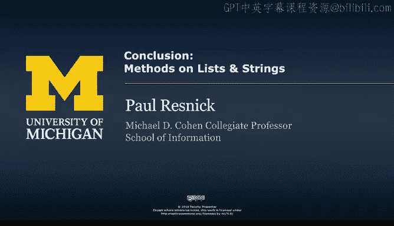

# 密歇根大学《Python3编程（课程1、2）》｜Python 3 Programming（Python for everyone进阶）（中英字幕） - P79：79_04_07_列表与字符串方法总结.zh_en - GPT中英字幕课程资源 - BV1CM411Z72u

You've now seen the most important methods that you'll be using on lists and strings。

And a few more obscure ones that you'll only rarely use。

You should now be able to read and write code using those methods。

 you should be able to extend a list using either a pen or concatenate to add more items onto the end of it。

And you should be able to identify whether a method mutates an object or creates a modified copy of it。

 methods on tus and strings， reminder they can never mutate them。

 they can only make modified copies because tus and strings are immutable。

Some operations on list mutate them， assignment， deletion， append， insert， reverse， So。

 remove and pop。 those all mutate lists， index and count。

 leave them alone and just tell you some property of those lists。So today's joke。

How can you get two cats in the same room。You can catnate them。See you on the flip side。

