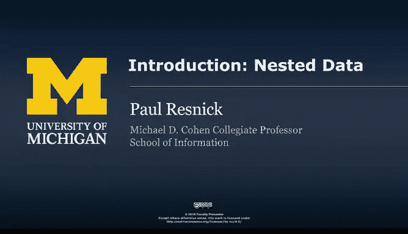

# 密歇根大学《Python3编程（课程3、4、5）》｜Python 3 Programming（Python for everyone进阶）（中英字幕） - P7：06_02_01_嵌套数据简介.zh_en - GPT中英字幕课程资源 - BV1gj41177yd

Welcome back， everybody。This lesson will teach you to deal with outer lists that contain inner lists and dictionaries as items。

And similarly， dictionaries whose values are lists or other dictionaries。

 We call it a nested data structure。It's a little bit like one of these Russian dolls。

 This one's painted as a robot where there's an outer doll and inside it， there's another doll。

 a sub list。And eventually， you get down to something that's not a container like a string or an integer。

Or。A turtle instance。But you might have to descend a few layers to get to it。In this lesson。

 we'll also get our first look at the JSON data format， which lets you。

It lets you represent a very nested list or dictionary as a long text string so that you can store it in a file and read it later or asend it to another computer。

At the end of this lesson， you should be able to use square brackets repeatedly to pull data elements out of a nested data structure。

And you should be able to read from and write to。Stings that are in the JSson format using the Python Json module。

I'll see you at the end for recap and some punny jokes。Bye for now。

