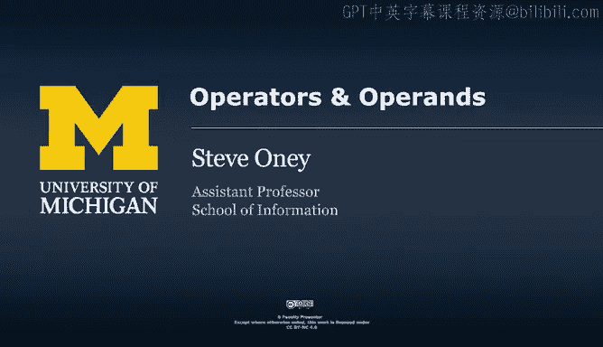
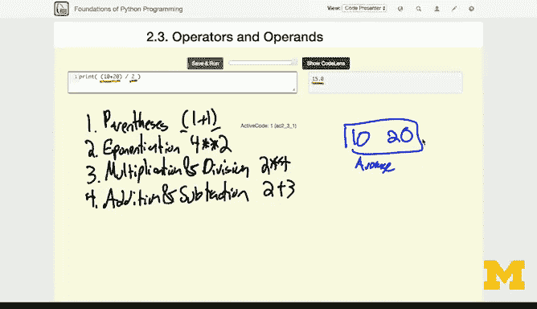

# 密歇根大学《Python3编程（课程1、2）》｜Python 3 Programming（Python for everyone进阶）（中英字幕） - P7：07_01_03_运算符与操作数.zh_en - GPT中英字幕课程资源 - BV1CM411Z72u

So far， we have seen simple expressions like 100 Hello world or 3。14。

 And these are all literal expressions where the value is the same as the expression itself。

But expressions are like building blocks that can be combined to form larger and more complicated expressions。

Operators are one way to combine expressions。The first operator that will' learn is the addition operator。

In order to use it。We write something like print out 100 plus200。When I run this code。

 note that I get the value 300。So when we execute a print statement。

 then rather than printing out the expression itself， the expression here being 100 plus 200。

 Then we print out the value of that expression。 So this expression。Has a value。Of 300。Now。

 this expression uses the addition operator， the addition operator。

 which is done using the plus sign， expects one expression to the left。

And one expression to the right。嗯。And what it does is it computes the value of the expression to the left。

And the value of the expression to the right。It adds up these two values。In then。

 the value of this overall expression。Is the value of this expression plus the value of this expression。

So in the case of 100 plus 200。We add the value 100 plus the value 200 and the value of this overall expression ends up being 300。

And remember that whenever we call print， we print out the value， not the expression itself。

 and so 300 gets printed in our output。Beyond the addition operator。

 Python includes many other kinds of operators， so their subtraction。

So when I print out the value of5 minus2， then we get3。If we reset our code here。

There's also a multiplication。Mulplication is done using the star symbol。

So when we print out the value of the expression two times4， then we get 8。There is also。Division。

So when I print out 10 divided by three。So division is done using B。Slash symbol。

 And when I print out the value of this expression， then it's 10 divided by 3， which is 3。

3 repeating。And in addition to addition， multiplication， division and subtraction。

 Python includes some other kinds of operators。 So you'll notice here that when we take 10 divided by 3。

 we had two integers， 10 and 3。And we got afloat as a result。

Sometimes we don't actually want that remainder， so Python also includes truncated division。

 which leaves out the remainder。So that we get three back。And it also includes the modulo operator。

 So if I say 10 and then percent sign 3。嗯。This is the module operator。

 so it gives me the remainder of 10 divided by 3， which is one。Python also includes exponentiation。

 So if I print4 star star2。Then this expression is like saying4 to the power of2 or4 squared。

 and so the value of this expression is 4 squared， which is 16。When executing code。

 Python follows the normal order of operations that you might be used to in math。

At highest precedence is whatever is in parentheses。And then below that is exponentiation。

So that would be something like4。To the power of two。Below that there's multiplication in division。

 so that would be something like2 times4。And then below that， there is addition and subtraction。

2 plus 3。So what this means is that suppose that we wanted to compute the average of two numbers。

 10 and 20。So if we wanted to compute the average of these two。Which should be 15。

 Then we might intuitively write something like。10 plus 20， divided by 2。Now， if I run this code。

 you'll note that I get 20。0 rather than 15， which is the actual average。

 And the reason is that because。Division is higher in precedence than addition。

 when computing the value of this expression， then Python first computes the value of 20 divided by 2 and gets 10。

0。And then it adds 10 plus 10。0 and gets the value 20。0。

If instead we wanted to first add 10 and 20 and then divide by2。

 then we could add parentheses around 10 and 20， so I would say print out 10 plus 20 in parentheses。

Divided by2。And now what Python is going to do is it's first going to add 10 plus 20 to get 30 and divide by 2 to get 15。

0。And you can see that now we're correctly getting the average of 10 and 20。

See you next time。