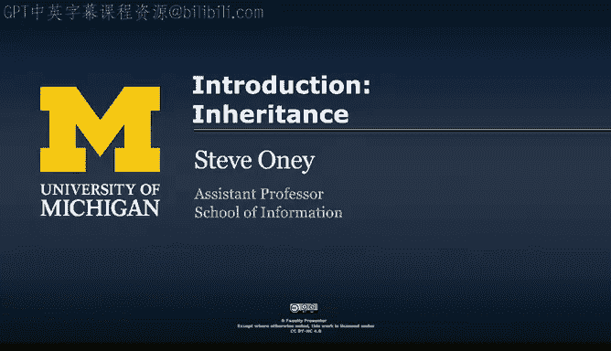

# 密歇根大学《Python3编程（课程3、4、5）》｜Python 3 Programming（Python for everyone进阶）（中英字幕） - P80：23_03_01_引言：继承.zh_en - GPT中英字幕课程资源 - BV1gj41177yd

Welcome back。In this lesson， we're going to learn about an idea called inheritance。

Inheritance will allow us to make classes better by making our code more reusable。

 readable and concise。😊，Now the basic idea of inheritance is that we can define something called a parent class or a super class in situations where we have multiple similar classes。

We can then say that our classes should inherit from that parent class。In other words。

 we're saying that every instance of our class should have everything that the parent class has plus more。

For example， suppose that we're writing code that represents animals in a game。

And suppose that we have one class to represent a dog in the game and another class to represent a cat。

Now obviously dogs and cats are different they do different things for example。

 your dog class might have methods for barking and fetching while your cat class might have methods for purring and chasing a laser pointer。

But despite their differences， there's a lot of similarities and overlap between these two classes and what they'll do。

For example， both dogs and cats might have properties that store their name and age。

 and they might have methods in common for eating and sleeping。Now， normally。

 we would have to define these methods separately for dogs and cats。

 so we might copy our code to declare an age and name instance variable across both class definitions。

But inheritance will allow us to create a superclass that both dogs and cats can inherit from。

So we might declare a parent class to represent an animal。

 and we can then say every animal has properties for age， name， and methods for eating and sleeping。

Then in Python， we'll be able to say that both dogs and cats are animals。

This will tell Python that dogs and cats should have every property and method that an animal has。

 so things like age and name and methods like eatat and sleep。

And now we won't have to copy our code for these common things across dogs and cats。

 we can dedicate our dog and cat method and property definitions to define the aspects that make them actually unique。

Now sometimes determining how to use inheritance most effectively is more of an art than a science。

 but regardless， it's a powerful tool that will help make our code more readable and concise。

 so let's get started。