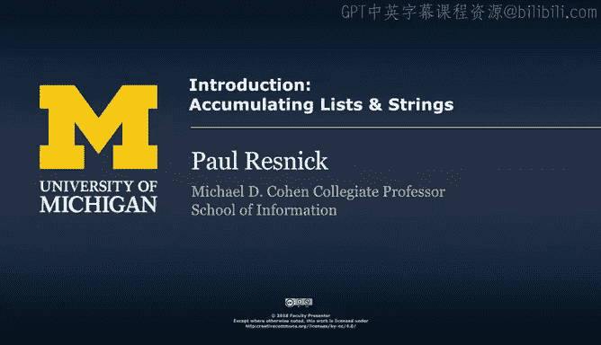

# 密歇根大学《Python3编程（课程1、2）》｜Python 3 Programming（Python for everyone进阶）（中英字幕） - P80：80_04_01_列表与字符串累积导论.zh_en - GPT中英字幕课程资源 - BV1CM411Z72u

Hi， welcome back。We're going to use the accumulator pattern a lot in this course。Previous。

 you've seen how to accumulate a number， a count or a sum。In this lesson。

 you're going to accumulate lists and strings with lists， you'll start with an empty list。

 and then you'll mutate it repeatedly by appending another item each time。With strings similarly。

 you'll start with an empty string and extend it repeatedly with concatenation and reassignment so that you get a longer and longer string accumulated。

At the end of this lesson， you should be able to read and write code that accumulates lists and strings。

See you later。