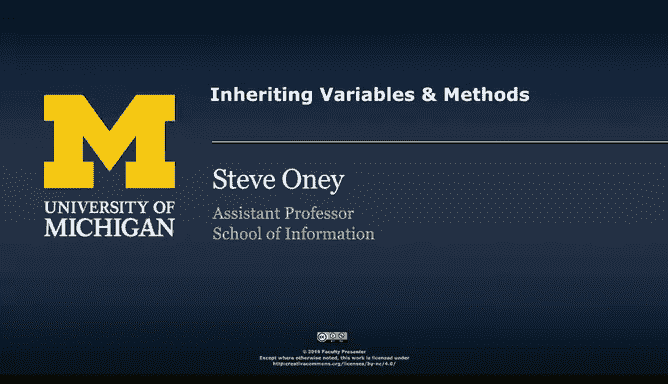
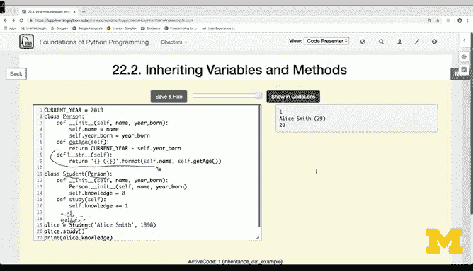

# 密歇根大学《Python3编程（课程3、4、5）》｜Python 3 Programming（Python for everyone进阶）（中英字幕） - P81：24_03_02_继承变量与方法.zh_en - GPT中英字幕课程资源 - BV1gj41177yd

Welcome back。So I'm going to start by defining a class to represent a person。

So I'm going to say class person。And let's say that every person has a name and a year that they were born。

 so I'm going to create a constructor， to underscore in knit。That accepts。A name and a year born。

And assigns instance variables for name and yearborn， self do name equals name。

 self do year born equals year born。Now， let's suppose that I also want to have a method get age。

 so get。Age。That takes this year born。 And let's suppose that we have a current year。

 So I'll define current。Year to be 2019。So get age is going to subtract current year。

 so I'll say return。Current ear。Minus self dot year。

And let's suppose that we also want to override the underscorecore STR method， so I'll say de。

 underscore STR， underscore。To print out self dot name。So I'll use the dot format method。And。

Thatt format self dot name and self dot get age。Okay。

 so now we have a class to represent a person and every person has a name and a year that they were born。

So if I create something like Alice。Equals。A new person。Named Alice Smith。

And I print out the value of Alice。I also have to pass an yearborn so to say 1990。Whoops。

I need one more closing parentheses here， okay。So now I can see that Alice Smith。

Is the name and 29 is the age， given that the year born is 1990。 Of course。

 we're just going to ignore things like exact birthdays for this purpose。Now。

 suppose that I wanted to define a new class to represent a student and what I want a student class to have is everything that a person has plus one more thing。

 so I want students to have this notion of knowledge。 So what I'm going to do。

I I'm going to start by just copying and pasting my person class。So I can do this。

And then let's suppose that I want to have another instance variable named knowledgeledge。

 which I'll start out as zero。So I'll say self dot knowledge。Equals 0。

And I want this to be student instead of person。And let's suppose that I want to have this other method on student named study。

 so deaf study。And whenever a student studies， then their knowledge should go up。

 so I'll say self that knowledge。Plus， equals1。Okay。

 so now if I define Alice to be a student instead of just a person。

By saying Alice equals a new student。Then you can see that I still get Alice Smith， age 29。

 if I print out。Alice dot knowledgeled。Then I should get0。If I tell Alice。

To study and then print out Alice's knowledge level， then I'm going to get one。Now。

 this is a fine way of defining both a person class and a student class。

 but there is a much easier and more concise way of actually doing this。

 using something called inheritance。 The idea of inheritance is that you can define classes that inherit from other classes。

 So in other words， they take all of the instance variables。

 all of the methods that that other class has， and then they can add more instance variables and more methods。

So in this case， every student is a person。It's not true that necessarily every person is a student。

 but every student is a person。 so what I'm going to do is I'm going to say that this student class should inherit from person。

So a student should have everything a person has plus more。Now。

 the way that I say I want student to inherit from person is by putting parentheses after the class declaration here。

And putting the class that I want to inherit from inside of those parentheses。

 So I'll say that every student is。A person。So now that I do this。

 I can get rid of some of the repetitive parts of the student class。 so here， for example， get age。

Is a little bit repetitive。 I don't need get age in both student and person because get age is already inside of person。

 So I'm going to remove get age from the student class。

Going to do the same for the underscoreco st r method。And I'm going to do one more thing as well。

 so this setting self。 name in self。earborn is a little bit repetitive with the person class setting self。

t name in self。 yearborn。So in the constructor for the student。

 I'm going to say that I want to call the constructor。This method of person。

 in the way that I'll do that is I'll say person。That underscorere， isn't it， underscoresre。

And I'm going to pass in self。Nim。In year born。Now， when I do this。

I'm going to call this inni method or the person constructor on this new student。

 So this is going to call this method。 And then this method is going to set instance variables for name。

And for yearborn automatically， so let's test this out with Alice and be sure that our code still works。

So you can see again we have our student Alice Smith， born in 1990。And if I still run this code。

 you can see that after Alice studies， then Alice's knowledge is one。But now if I print out。Alice。

 get age。You'll see that Alice is 29。 if I print out Alice。Then you'll see that we get Alice Smith。

 age 29。 And the important part here is that even though Alice is a student and even though the student class didn't directly define Dcore S R。

Or get age。I'm able to call both of these methods on Alice because Alice is a student and student inherits from person。

 and the person class has these methods get age and underscore STR。

That's all for now， until next time。