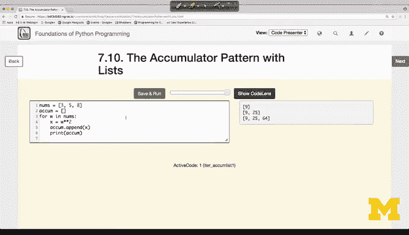

# 密歇根大学《Python3编程（课程1、2）》｜Python 3 Programming（Python for everyone进阶）（中英字幕） - P81：81_04_02_列表累加器模式.zh_en - GPT中英字幕课程资源 - BV1CM411Z72u

Welcome back。You've seen the accumulator pattern before， now we're going to accumulate a list。

Instead of a number。So， in this code example。As with all accumd patterns。

 we have to have some sequence that we're going to iterate over。In this case， we have。

We have a variable nus。That we are binding。Do a list containing three。5。And 8。

And we're now going to accumulate a list， we'd like that list to contain the squares of all the numbers from the original list。

 so 9， 25， and 64。As with all accumulated patterns。You have some accumulator variable。

 I'm going to call it。Acuum。We could call it something else， maybe。Squares would probably be。

A reasonable choice。And anyway， it's called the Hue here。

And we initialize it to be just an empty list。And this is typical when we're accumulating a list。

 we start with an empty list and we're going to keep appending to it。

This is the analog of starting with zero when you're going to take an accumulation that gives you a sum。

We start with the empty list and then on line three， we start our iteration。So， we're gonna。

Iterate each time W is going to be bound to one of the items from nus。In the first iteration。

 W will be bound to three。Will said。Next。To be the square。Of three or9。

 And then we're going to append。The current value of x，9。Into the accumulator。

On the second iteration， W gets bound to。The second。Liaoyu。5。And so。X gets bound to 25。And we append。

25。The third time。W is 8。X is 64。164。Gets appended to the list。

So this is following the same logic of your accumulator pattern before。Each time through。

This iteration。An additional item is going to be appended into a cube。

 and so really a cube is the squares so far。That we've managed to accumulate。

When we're done with this iteration， we finished with。All three of。All three of these。

We can print out a cube and a cube will have all of the squares。So let's run it。Sure enough we get 9。

 25 and 64 at the end。So as a little check on your understanding， let me try changing one thing。

In this， suppose that I indent。That print。Can you predict what the output will be。

It's a good chance to。Pause and see if you can predict it。At each stage。

We're now going to not just change the contents of the accumulator。

 but we're going to print what we've accumulated so far。

So we're now going to have three lines of output。First， just the list 9 and then list with 9 and 25。

 and then the list with 9， 25 and 64。So as before， this is a useful debugging strategy。

What the accumulator pattern is to print out what you've accumulated so far and see how it grows over time。

So in summary， to accumulate a list， you will initialize the accumulator to be an empty list。

You'll iterate and at each iteration， you'll append a new item。At the end，voilah。

 you've accumulated a new list。

Catch you later。