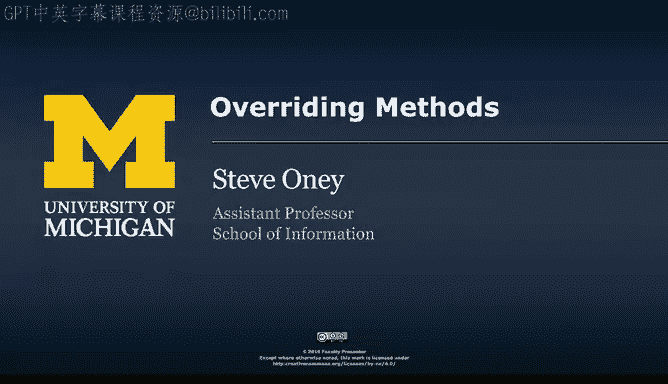
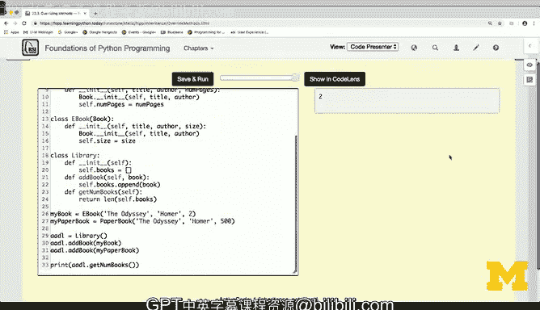

# 密歇根大学《Python3编程（课程3、4、5）》｜Python 3 Programming（Python for everyone进阶）（中英字幕） - P82：25_03_03_方法重写.zh_en - GPT中英字幕课程资源 - BV1gj41177yd

Welcome back。 So we've already covered inheritance。

 but it's worth talking about when we actually want to inherit and how we want to inherit at times。

So in general， the way that Python uses inheritance is that let's suppose that we have a super class。

 so I'm going to represent。Classes by this factory， I think a factory is a good metaphor for classes。

 a factory for constructing instances。So let's say that this red factory represents a super class。

And a superclass is the class that we're inheriting from。Let's suppose that this blue factory。

Represents a subclass。So the subclass inherits from the superclass。

 I'm going to represent that just by having this little red dot here。

 and that's like a line representing that we remember that this subclass is inherited from that superclass。

And then we， of course， have instances， so we might have an instance。

And let's suppose that this instance is of the subclass。

And I have this blue dot here to represent that Python remembers that that instance。

Is an instance of this subclass。Now， whenever Python is looking for any method or instance variables。

 it's always first going to look in the instance。So it's first going to look inside of the instance。

And it's going to ask， does the instance have that thing， if it doesn't。

 then it's going to look inside of that instances class。And it's going to ask。

 does that instance class have that instance variable or method， if it doesn't。

 then it's then going to look into the super class。And in Python。

 that's just how super classes work by adding this extra layer。

Of looking at the superclass for things that are missing in the subclass。

 what we do is we inherit everything that the superclass has and more。

So this kind of gets to the question of when should we actually inherit from a super class？Well。

 you should only inherit if your subclass。Should have absolutely everything that the superclass has plus more。

 or maybe plus some small modification。So let's go over an example of this。

So let's suppose that I want to represent books in the library。

 and let's suppose that we have two kinds of books， we have paper books， and we have ebooks。

So the way that I would represent that in classes is I would have one super class for book。

 so I'd say class book。And every book is going to have a title and an author。S I say de， Tco and it。

And that's going to take in a title and an author。And I'm just going to set self do title。

That title equals title， self do author equals author。

 and let's suppose that we have this underscore STR method as well。And we're going to return。

Title by author。Okay。So now I have this book class。 I can create a new book， so I'll say。

My book equals a new book。And let's suppose that the title is the Odyssey。By Homer。And then。

 if I print out。My book。Then I'll see that my book is the Odyssey by Homer。Let me actually。

Add quotation marks around this when we print out the book title。Okay。

 now let's suppose that a library can have two kinds of books。

 let's suppose that it can have ebooks and paper books。

So both ebooks and paper bookss have everything that a book has plus more in the case of a paper book。

 maybe we have a number of pages， Sal say class， paper book inherits from book。

And I'm going to have a constructor。That takes in a title， author， and none pages。

Then I'm going to call the book constructor， so I'll say。Book dot underscore in it。With self。

 title and author。Then I'm going to assign an instance variable nu pages。

 so I'll say cell dot nu pages equals nu pages。So that's a paperbook。Now。

 let's suppose that an electronic book doesn't have pages， but it has a file size， like 3 MB，5 MB。

 hopefully not a gigab for a book， but it has some size。 So I'll say class。Ebook。Inherits from book。

 So just like a book， an ebook is going to have a title in an author。And I'll say de， underscore。

 init， underscore， self， title， author， and then instead of none pages， it has size。Again。

 that's going to be the number of megabytes that this ebook takes off， so I'll say。Book dot in it。

With self， title and author。And I'll say self dot size equals size。Okay。

So now let's say that my book is an ebook with the Odyssey by Homer。

 and let's say that it's two megabytes。So if I print out my book。

 then I can see that it's still the Odyssey by Homer if I print out my book dot size。

Then I can see that it's  two megabyte。If this is instead a paper book， so。

Let's suppose that I also have a paper copy of this book， my paper。Book equals new paper book。

 the Odyssey by Homer。 And let's say that it has 500 pages。Then I can see that。My paper。Book。

That size。Os， it doesn't have size instead it has none pages。Because。Paper books don't have a size。

 they have none pages。So I can see that my paperbook dom pages is 500。So in this example。

We wanted to create paperbook and ebook as separate subclasses because in this case。

 a paper book has everything that a book has， so in this case a paper book has a title and an author。

And so does ebook， so ebook has everything that a book has so it has title and author。

 and paper book also has this additional thing， none pages， and ebook has this additional thing。

 bio size。So。That's when you want to inherit， when you want to have a subclass that has everything that the superclass has plus more。

When you don't want to inherit is when you want to contain another class within a class。

 So let's go through an example。 So let's suppose that I don't want these books to exist in isolation。

 Let's say that I want to have a library class and libraries are going to contain books。

So what I'm going to do is I'm going to say。Class library。

And every library has some fixed number of books， so I'll represent that by saying de。Andね。

Se and I'm going to say that every library starts off with zero books。

 So I'll say self doc books is an empty list。And then we can add books to our library catalog。

 So I'll say de add book。So， and then book。And here， book is going to be an instance of book。

 So whether it's a book， a paper book or an ebook， what we do is we add that book to our list of books。

 So I'll say self。 books append book。And I'll say de， get size。

This is going to return the number of books that we have， so I'll return the length of self do book。

I'll actually give this a clear name， get number of books。Okay。

So the important point that I want to highlight here is that even though there's some relationship between library and these book classes in that a library contains a list of books。

 we didn't want to inherit from book or we didn't want book to inherit from library。

 because it's not that a library has everything that a book has， it doesn't。

 or that a book has everything a library has， it doesn't either。

 It's just that libraries contain books。 So rather than inheriting from books。

 I created a separate instance variable， to actually contain this list of books that we have So this is an example of what's called composition。

 So a library contains or is composed of a list of books。

 So rather than inheriting from the book class， then we want to have a list of books as our instance variable。

 So let's see our class in action。So let's suppose that I have the Ann Arbor District Library。

 AAL equals a new library。And I say ADL do add book。My book。And AL add book， my paper book。

Now if i print out a a d l do getm books，then i'm going to see that my district library has two books。

That's all for now， until next time。

