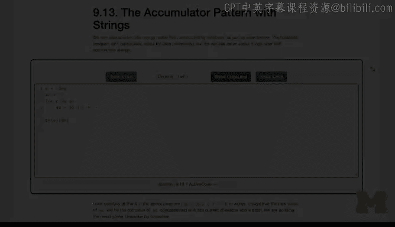
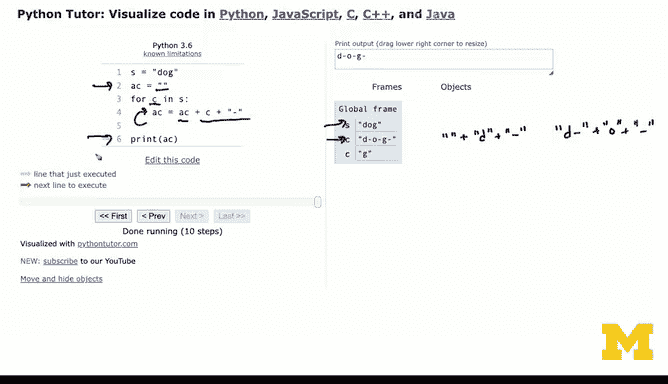
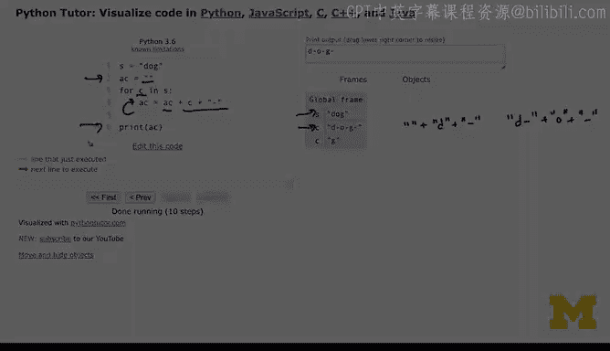

# 密歇根大学《Python3编程（课程1、2）》｜Python 3 Programming（Python for everyone进阶）（中英字幕） - P82：82_04_03_字符串累加器模式.zh_en - GPT中英字幕课程资源 - BV1CM411Z72u

Welcome back。We can also use the accumulator pattern to accumulate strings。In this case。

 you start with an empty string and keep appending to it。So I started on line to。

 AC is my accumulator variable， and I gave it an empty string as its initial value。

Each time through the iteration。I took its old value。Appended some more stuff。

 incatenated some more things。 And I had to reassign it。To the accumulator variable。

This is different than what we did with lists because with strings， you can't mutate a string。

 you can only make a new string。And so you have to reassign。

So we're going to take the string dog and we're going to keep adding dashes after each of the letters。

Let's run this in code lens and see how it works。Here I have code lens running in its own tab。

So in the first step， we just assign the string dog to the variable S。Initially。

Initialize the accumulator variable to be an empty string。And that's happening over here。Initially。

 theane later variables and empty string were now iterating through all of the letters in dog。And。😔。

Each time to the iteration， C is going to be bound to a different letter the first time。

C is bound to the first letter in dog， C is bound to D。And then AC is going to get a new value。

 it's going to get its old value。Which is an empty string。Plus。Whatever the value of C is。

 which is the letter D。Plus。A hyphen or dash。And I cancatenate all those together。

It should be D dash。And that's what I'm expecting the new value for AC to be when I go on to the next step。

Exactly as I was hoping， AC is now D dashash。Notice that the string as， of course。

 hasn't changed at all。We're ready to do the next iteration on the next iteration C is now the letter O。

And AC is D dash， so it's as if we have。Ddash。Plus，0。Plus， a dash。And that is going to give us。

The dash O dash and finally。We do it a third time， we're going to get G dashash。

We're now done with the iteration。And our aumulator variable has our final accumulated result。

So in summary， to accumulate a string。Your accumulator variable starts with an empty string。

On each iteration。You do something that makes a new string out of the old value of the accumulator and some other stuff。

Something involving the iterator variable。 and you have to reassign it。Into the accumulator variable。

 because you can't mutate a string。At the end， your aumulator value your accumulator variable。

 AC has the final value。

See you next time。

