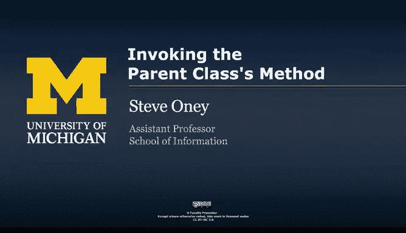
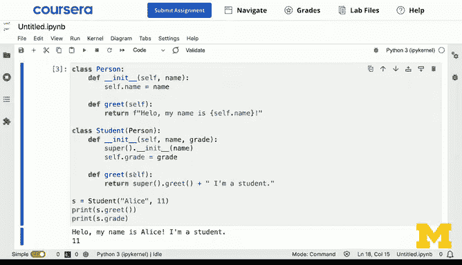

# 密歇根大学《Python3编程（课程3、4、5）》｜Python 3 Programming（Python for everyone进阶）（中英字幕） - P83：26_03_04_调用父类方法.zh_en - GPT中英字幕课程资源 - BV1gj41177yd

Welcome back in Python we often want to call a superclass method from a subclass。

 so let's take this code， for example， here we have a super class named person which represents a person。

 every person has a name， and we also have this greet method inside of person。

And then we have a subclass of person called student。

So every student is a person and if we define a student。

 then it's going to inherit this name attribute from person as well。

 but let's suppose that the student，Also has its own greet method。

 and we want to refer to the person's greet method from student。So。If we run this code。

 then what you'll see is that here inside of the student's greet method。

 we first call the person's greet method which says hellello， my name is， and then the person's name。

 so hello my name is Alice， but then we add the additional， I'm a student。Which you can see here。

Now there's actually a better way of doing this， however。

 this doesn't work in the Runonestone textbook， so I'm doing this in Jupiter。

Python includes a built in function named Super。So if I say super。

And what this does is it references the parent class of whatever class I'm in。

 so what I can do is I can actually replace person doc greet。With Super dot greet。

And I no longer even need to pass in self as an argument。So you'll see that if I do this。

 then it still works。Now one advantage of this is now if I call Super， if I decide to， for example。

 rename my person class or change which class student inherits form。

 then I don't need to change the code to reference that new class。

 Python just kind of automatically does that for us。

So the super function here returns something called a proxy object that's going to delegate method calls to the superclass of the class。

 so we can call methods from the superclass using this proxy object。

 so we just say super dot and then whatever method we want to call from the superclass Also note that we didn't need to pass in self as an argument to super。

t greet。Because super takes care of this for us。Now。

 we can also use super in the context of things like_co methods， so let's suppose that。

We have a underscore in knit on student。So let's suppose that every student also has a name。

 but also a grade。And let's suppose that we want to use the persons initializer within student so again。

 we could say person。Thatt underscore in it。Called with self。And name， and then we could say self。

t grade equals grade。Again， we could do this， but a better way of doing this would be to say super。

Dot in it。And then we don't need to pass in self anymore either。

 So we could say super dot underscore in it with name and grade， so。If Alice is in grade 11。

 for example。And we print out。S dot grade。Then you can see that that works。

So Super is a better way to be able to access the methods and attributes from a superclass without having to hard code the superclass's name。

 and this can make our code more flexible and easier to maintain。That's all for now until next time。

