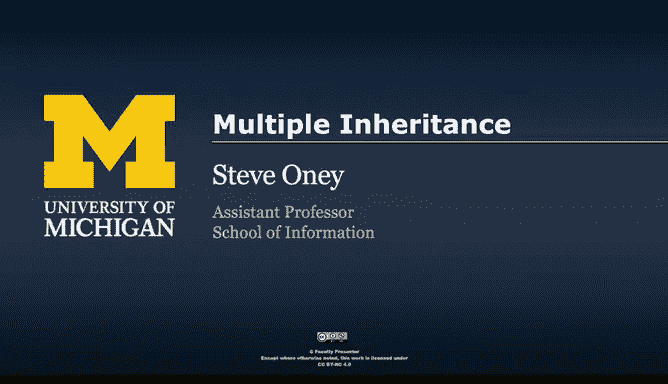
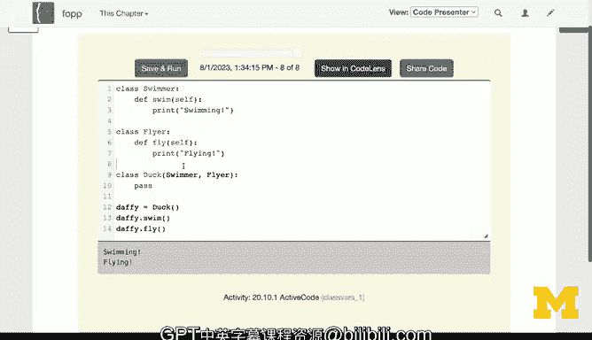

# 密歇根大学《Python3编程（课程3、4、5）》｜Python 3 Programming（Python for everyone进阶）（中英字幕） - P84：27_03_05_多重继承.zh_en - GPT中英字幕课程资源 - BV1gj41177yd

Welcome back。So here we have a piece of code where we declare a class swimmer that has one method for swimming。

 and in this swim method， we just print out swimming。

 and we have a class duck that inherits from swimmer and here our duck class is empty so we just say pass。

Now we can create a new instance of duckuck by saying。For example， Daffy equals duckuck。

And if I call day。wim。And of course， we get swimming。

Python also allows us to inherit not only from one class but from multiple classes。

 so let's suppose that we have another parent class called flyer。

And let's suppose that the flyer class has a fly method that just prints out flying if I want to say that a duck inherits from both swimmer and flyer。

 then I can add after swimmer I can add a comma flyer。

And what this is going to tell Python is that the duck class has two parent classes。

 swimmer and flyer， so it's going to inherit from both of them。

 and what that means is that I can also call daffy。Dot fly。And you can see here。

 we're inheriting the fly method from the flyer class。So just like single inheritance。

 multiple inheritance can improve our ability to reuse code in classes。

It can be especially useful if these classes represent some sort of features that we can selectively apply or remove from subclasses。

But whenever possible， we try to avoid multiple inheritance because it adds an extra layer of complexity on top of our code。

 especially if these parent classes are complex， or if they inherit from other classes themselves。

 In that case， than it can be tougher to predict how the child class is going to behave。

 So we usually try to consider simpler alternatives before turning to multiple inheritance。

 For example， sometimes we can use composition as a substitute for multiple inheritance and composition is when we use an instance of one class as an instance variable in another class。

 sometimes we can use single inheritance， and sometimes we can use class decorators。

 which well learn about in a future lesson。

That's all for now， Until next time。