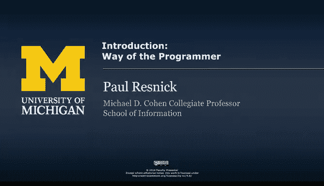

# 密歇根大学《Python3编程（课程1、2）》｜Python 3 Programming（Python for everyone进阶）（中英字幕） - P84：84_04_01_程序员之道进阶导论.zh_en - GPT中英字幕课程资源 - BV1CM411Z72u

Welcome back。 In this week's way of the programmer lesson。

Will be encouraging a habit of drawing reference diagrams。

And offer some tips on how to recognize when to use the accumulation pattern and how to do it well。

The learning objectives at the end of this lesson， you should have developed the habit of drawing a reference diagram to resolve any potential confusions。

And you should be able to recognize when you should use the accumulation pattern based on the words that are in the problem statement。

See you at the end。