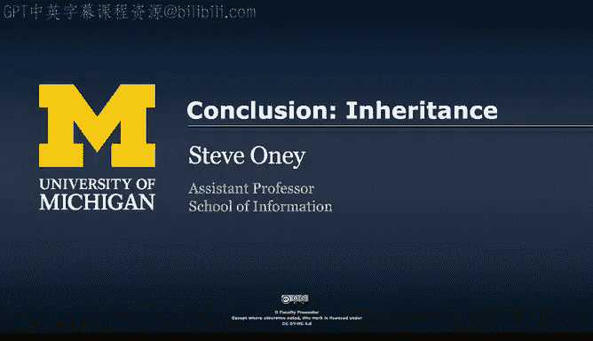

# 密歇根大学《Python3编程（课程3、4、5）》｜Python 3 Programming（Python for everyone进阶）（中英字幕） - P85：28_03_06_小结：继承.zh_en - GPT中英字幕课程资源 - BV1gj41177yd

In this lesson we learned about inheritance inheritance allows us to better reuse code by allowing classes to inherit attributes and methods from parent classes so that we don't need to rewrite repetitive code from the parent class。

But deciding when to use inheritance can be a little bit tricky。

 so I would say that one important question to always try to ask is whether a potential subclass has a has relationship or an is relationship with a potential parent class。

For example， suppose that you're working in the space of defining classes to represent different kinds of vehicles and suppose that you've defined a vehicle class。

Now it would make sense to make a car class inherit from vehicle and it would make sense to have a truck class in from vehicle because a car is a vehicle and a truck is a vehicle too。

However， it would not make sense to have vehicle inherit from a wheel class or to have wheel inherit from vehicle because a vehicle is not a wheel and of course a wheel is not a vehicle。

That said， in most cases， a vehicle has a wheel， so instances of wheel might be instance variables in the vehicle class。

So in this case it makes sense to make car and truck inherit from vehicle。

 but it wouldn't make sense to have wheel inherit from vehicle。

 even though theres a relationship between the two。Now， rather than a joke for this lesson。

 I want to tell you about a thread on social media that I thought was funny。

 and it was about a programmer who uses a language named Colbal。 and Colbal is a pretty old language。

 it was created back in 1959。 and this programmer was actually working with a codeb that was written decades ago。

 In fact， this programmer came to find out that the person who originally wrote the codeb was their very own mother。

 So Colbal might not be an object oriented language， but if that's not an example of inheritance。

 then I don't know what is。See you next time。

